# 2026-10-19 Everything is a DAG!

By [Vincentius Timothy](https://registry.jsonresume.org/vincentimo).

I'd argue that many things in our lives can be modeled as DAGs. But what is this DAG thingy?

## What is a DAG?

[DAG](https://en.wikipedia.org/wiki/Directed_acyclic_graph) stands for Directed Acyclic Graph. But don't let the big words get to you. Basically, it's a special kind of **graph**, where there's a clear **direction** of what goes to where, and you can't go back to previous nodes to form a never-ending cycle (**acyclic**).

(Some people also call it **acyclic digraph**, but let's stick with DAG.)

Let's see it in action.

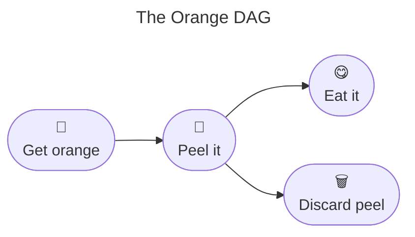

You see, the Orange DAG is a DAG because:

1. It's a **graph** (duh).
2. It has **direction**. You have to get an orange before you can peel it. After that, the direction branches in parallel, so you can either:
	1. eat the orange (and discard the peel later), or
	2. discard the peel first (if you feel like having a clean table while eating the orange), or
	3. get a friend to discard the peel while you're eating the orange.
3. It's **acyclic**. After you peel the orange and eat it, you can't go back to re-peeling it.

Here's the **invalid** version of the Orange DAG due to a cycle.

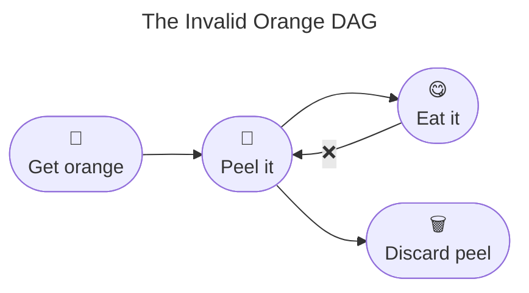

Now, let's see a more complex DAG in action.

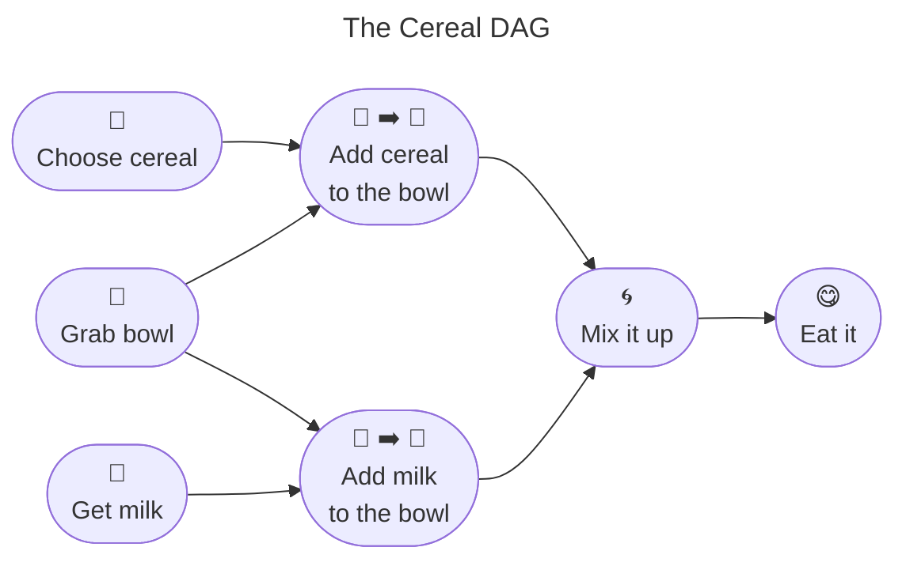

The Cereal DAG highlights a very important concept: **dependency**. Let's trace how the nodes relate to each other:

1. **Grab bowl** has 2 direct downstream: **Add cereal to the bowl** and **Add milk to the bowl**.
2. Tracing further forward, **Grab bowl** has 4 total downstream: The 2 direct downstream, plus **Mix it up** and **Eat it**.
3. **Mix it up** has 2 direct upstream: **Add cereal to the bowl** and **Add milk to the bowl**.
4. Tracing further backward, **Mix it up** has 5 total upstream: The 2 direct upstream, plus **Choose cereal**, **Grab bowl**, and **Get milk**.

Other than upstream → downstream, you can use different terms to describe dependency:

| Term pair + direction      | Distance       | Usually used in                                |
| -------------------------- | -------------- | ---------------------------------------------- |
| 1. Parent → Child          | Exactly 1 step | Computer science, data structures              |
| 2. Predecessor → Successor | Exactly 1 step | Task scheduling, workflows, project management |
| 3. Ancestor → Descendant   | 1+ steps       | Graph theory, genealogy                        |
| 4. Upstream → Downstream   | 1+ steps       | Data pipelines, stream processing              |

> [!NOTE]
> A DAG is ideal to describe any system with a **strict forward direction** and **zero cycles**, especially when you want to track **parallel** workflows or highlight **dependencies**.

Now, is everything really a DAG? Let's see.

## Group 1: Everyday structures

### 1.1 Family trees

Wait, is the **[family "tree"](https://en.wikipedia.org/wiki/Family_tree)** a DAG? Let's see an example.

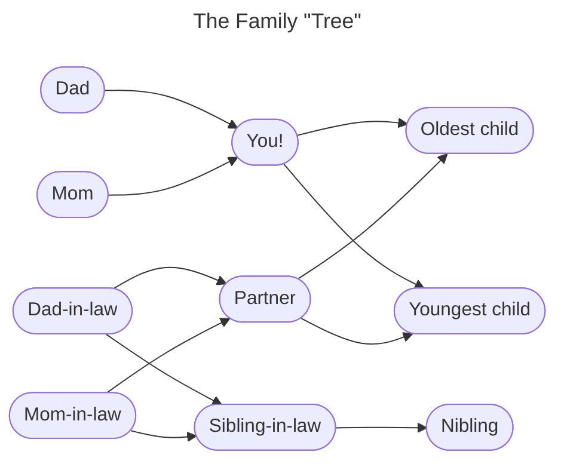

So you see, the family "tree" is a DAG because:

1. It's got **direction**. Parent nodes directly point towards the child nodes. **Note**: A DAG represents parent-child / generational relationships, not romantic ones. You and your partner are represented as co-parents towards your children, rather than pointing to each other.
2. It's **acyclic**. Unless you've got serious time-travel shenanigans, you can't possibly be the parent of your own dad nor mom. **Note**: While it's entirely possible for you to be the parent of your dad-in-law, your mom-in-law, or both (and the DAG will still be valid), the moral implications are, let's just say, outside the scope of this article 💀

But wait! Maybe the family "tree" is both a DAG and a tree? What is a tree, anyway? Well, it really depends on who you asked.

1. A **computer scientist** would say a [tree](https://en.wikipedia.org/wiki/Tree_(abstract_data_type)) is a directed graph, with no cycles (i.e., a DAG), with a restriction: each node may have up to 1 (one) parent. There is no restriction on how many children it may have, though.
	1. The topmost node without a parent is called the **root** of the tree.
	2. Nodes with no children are called the **leaves** of the tree.
2. A **mathematician** would say a [tree](https://en.wikipedia.org/wiki/Tree_(graph_theory)) is a strictly undirected graph, with no cycles. If you add a direction, it stops being a tree, and becomes a directed tree.

Here's the comparison between a DAG, a computer scientist's tree, and a mathematician's tree.

|                                        | DAG                                        | Computer scientist's tree | Mathematician's tree                         |
| -------------------------------------- | ------------------------------------------ | ------------------------- | -------------------------------------------- |
| **Got direction?**                     | ✅                                          | ✅                         | ❌                                            |
| **May contain cycles?**                | ❌                                          | ❌                         | ❌                                            |
| **How many parents a node may have?**  | No restriction                             | Up to 1 (one)             | Not applicable                               |
| **How many children a node may have?** | No restriction                             | No restriction            | Not applicable                               |
| **Physical interpretation**            | Nodes can both separate and merge together | Nodes can only separate   | Nodes just link together (no cycles though!) |

Let's see an example of a computer scientist's tree.

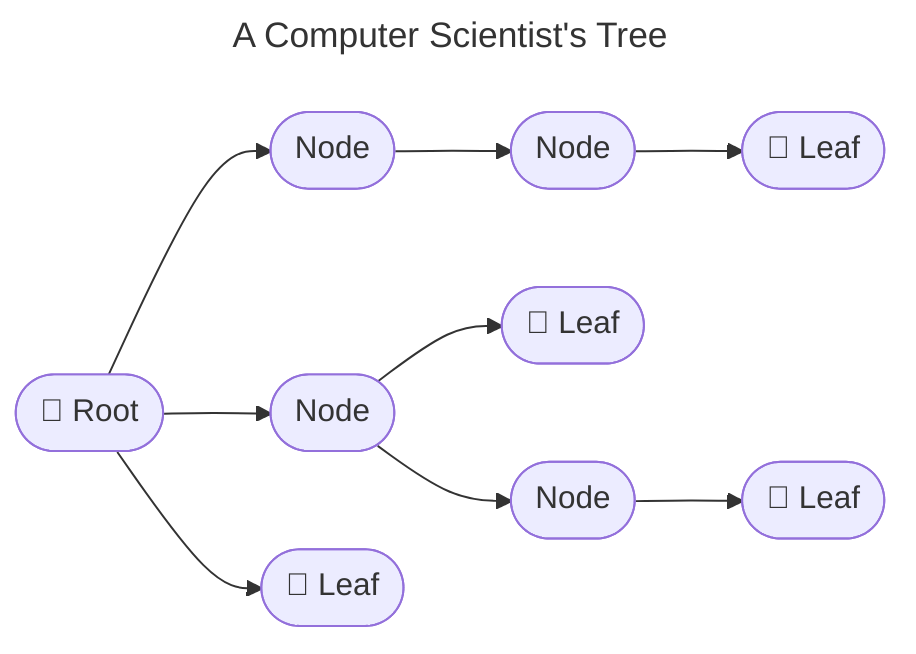

> [!NOTE]
> 1. Every tree (computer science) is a DAG, but not every DAG is a tree (computer science).
> 2. A family "tree" is not a tree (despite the name) because a node in the family "tree" has 2 parents, which violates the strict single-parent restriction of a tree.

Now, let's see a more complex family "tree" (maybe suitable for a [soap opera](https://en.wikipedia.org/wiki/Soap_opera) 💀). Can you still see how it's a DAG and not a tree?

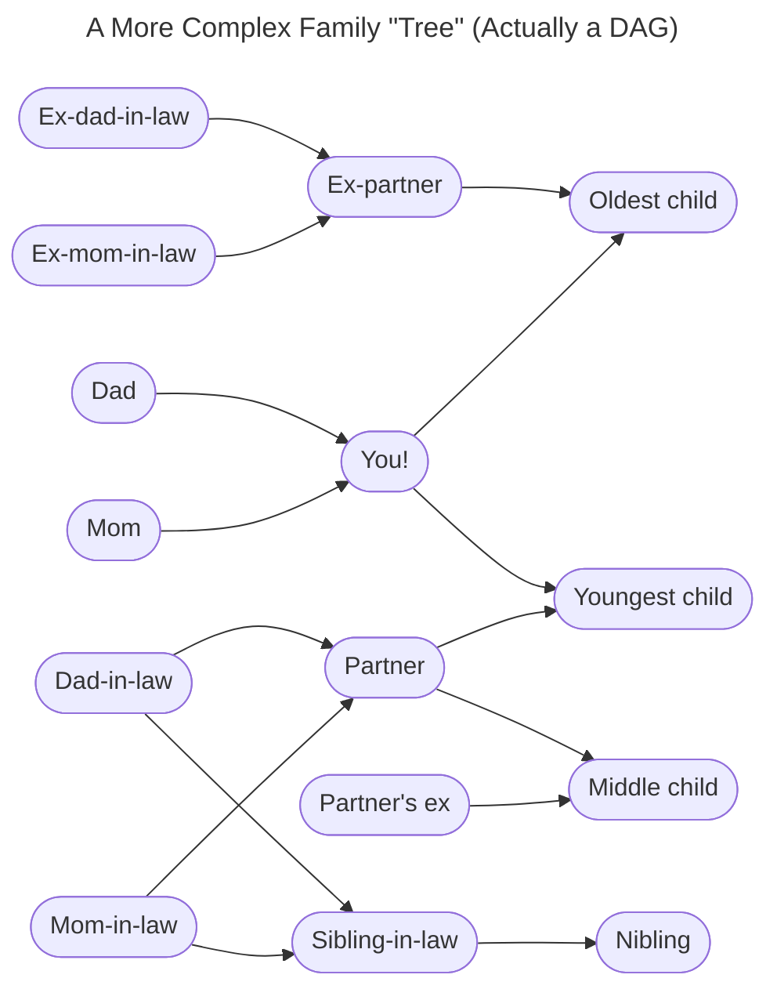

### 1.2 Tech + skill trees in games

With the same logic, many **[tech "trees"](https://tvtropes.org/pmwiki/pmwiki.php/Main/TechTree)** in strategy games and **[skill "trees"](https://tvtropes.org/pmwiki/pmwiki.php/Main/SkillScoresAndPerks)** in role-playing games (RPGs) are actually DAGs. Why? Because an advanced perk may require **multiple prerequisites**. A design in which every node has only one prerequisite can still be a true tree.

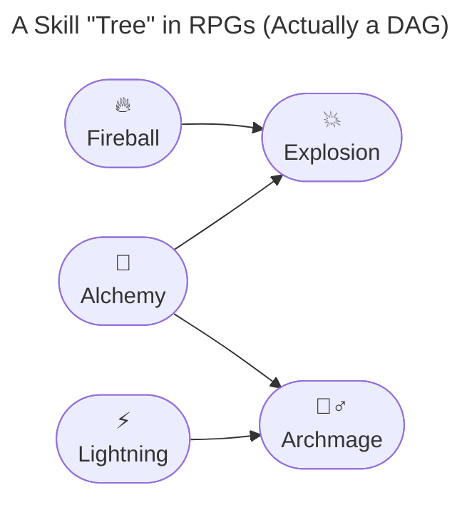

For example, unlocking **Explosion** might require you to research both **Fireball** and **Alchemy**. Two separate parent nodes point towards a single node, which violates the strict single-parent restriction of a tree.

> [!NOTE]
> Family "trees" and many tech / skill "trees" are better represented as DAGs when a person or perk can have multiple parents. A tree is a special case of a DAG, so the label "tree" is not automatically wrong.

### 1.3 The evolution of species

Speaking of trees that aren't always trees, biology textbooks often draw the grand "Tree of Life." A branching tree is useful for many evolutionary histories, but it cannot represent every kind of ancestry.

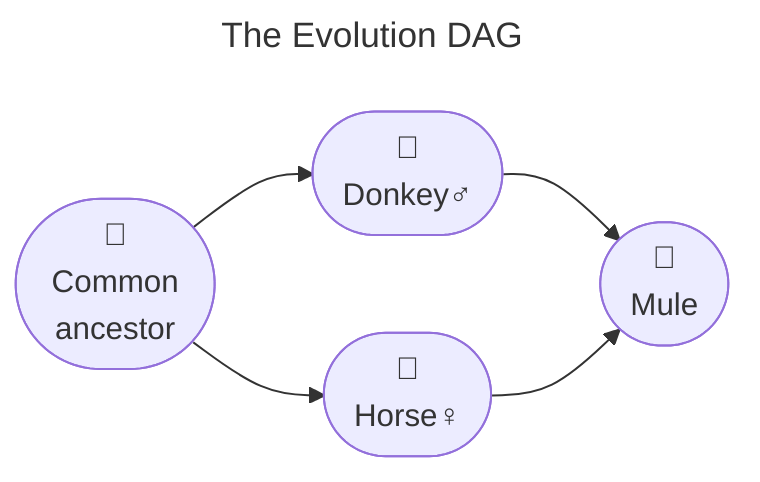

Many evolutionary histories can be represented as branching trees. However, hybridization, introgression, and horizontal gene transfer can connect lineages in ways a simple tree cannot capture. Researchers use [**phylogenetic networks**](https://en.wikipedia.org/wiki/Phylogenetic_network), often modeled as rooted DAGs, to represent such reticulate histories. This illustration is a toy example of hybridization between a male donkey and a female horse; it is not a literal species tree, and [mules](https://en.wikipedia.org/wiki/Mule) are usually sterile.

### 1.4 University course prerequisites

If biological lineages can merge, academic structures trap you in them. Ever tried registering for classes only to find out you're blocked by several prerequisites? Blame DAGs.

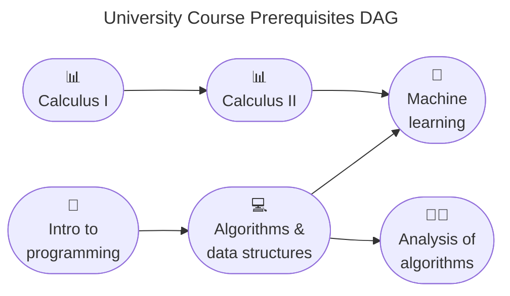

University courses form a classic structural DAG because you must pass prerequisite classes before taking advanced ones. If the university somehow required you to take **[Algorithms & data structures](https://en.wikibooks.org/wiki/Data_Structures)** before **[Intro to programming](https://en.wikibooks.org/wiki/Introduction_to_Programming)**, well... good luck to your education 💀

## Group 2: Everyday workflows

### 2.1 Culinary recipes

Moving from everyday structures to things we actively execute, cooking can be a form of parallel processing with dependencies.

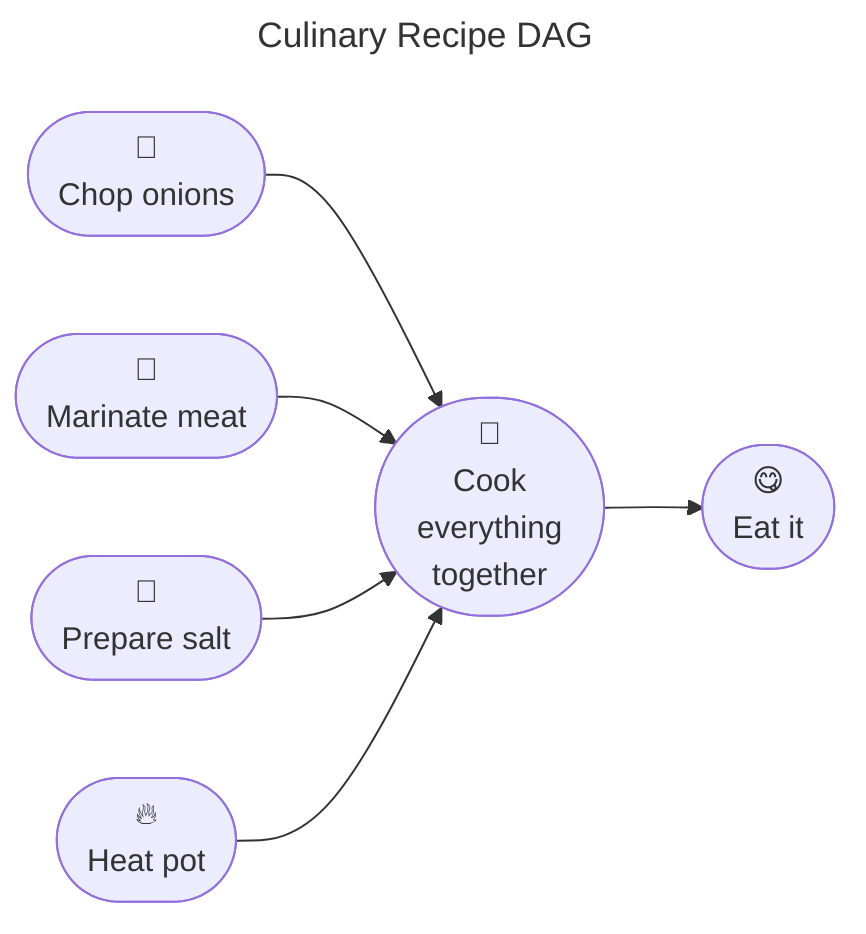

A recipe can be modeled as a DAG when its steps and prerequisites are represented explicitly. For example, you need to chop the onions before adding them to the pot, while chopping and marinating may happen in parallel. Real cooking can involve retries or adjustments, but those can be left out of a simplified dependency graph.

### 2.2 Project management

If you've ever set foot in an office, you've probably encountered a project workflow that can be modeled as a DAG.

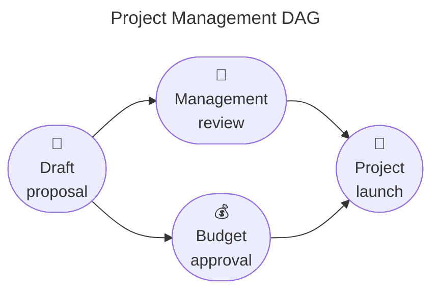

Tasks have strict dependencies. You cannot launch a project until both Management and Finance give their green lights. It's a DAG designed to keep everyone moving forward, even if corporate bureaucracy sometimes makes it feel like an endless, sanity-draining loop.

### 2.3 Spreadsheet cell calculations

And what do we use to track all those tasks and budgets? Spreadsheets. Microsoft Excel and Google Sheets are secret DAG engines hiding in plain sight.

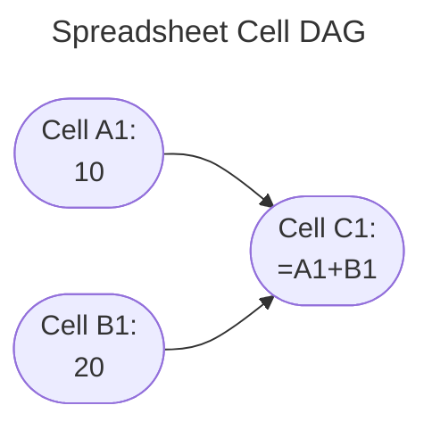

When you write `=A1+B1` in cell `C1`, you create dependencies: `C1` depends on `A1` and `B1`. If you also make `A1` depend on `C1`, you create a circular reference. Excel flags circular references by default, although iterative calculation can be enabled for models that intentionally use them ([documentation](https://support.microsoft.com/en-us/excel/remove-or-allow-a-circular-reference-in-excel)).

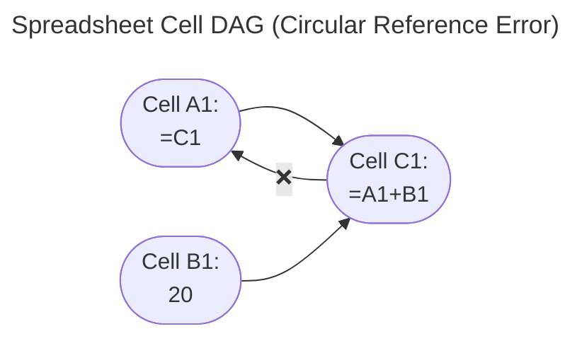

## Group 3: Time-travel shenanigans

### 3.1 Save scumming in games

Speaking of escaping loops, what happens when you bend time itself? You save the game just before a risky encounter (e.g., boss fight), then reload the save after a failure and try again. This is [save scumming](https://tvtropes.org/pmwiki/pmwiki.php/Main/SaveScumming). Its **attempt history** can be represented as a DAG if each retry is modeled as a distinct node.

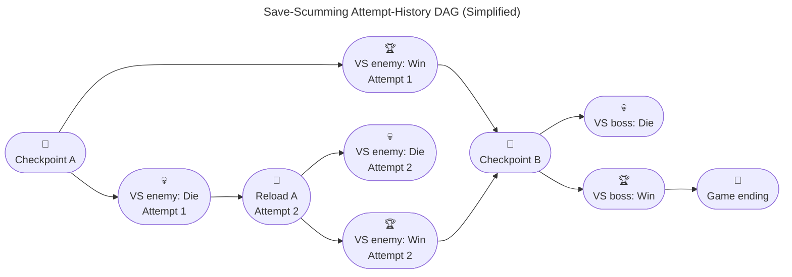

When you save your game before an encounter, die, and reload to try again, the game state appears to loop backward. The diagram keeps the graph acyclic by treating the reload as a new, time-indexed attempt node. If every reload pointed back to the very same checkpoint node, the graph would contain a cycle instead. As a result, this is a DAG of attempt history, not a full graph of reusable game states.

### 3.2 Git commit history

If save-scumming lets you rewrite personal gaming history, [Git](https://en.wikipedia.org/wiki/Git) lets you do it professionally. Every time you [commit](https://en.wikipedia.org/wiki/Commit_(version_control)) code, Git builds a timeline DAG behind the scenes.

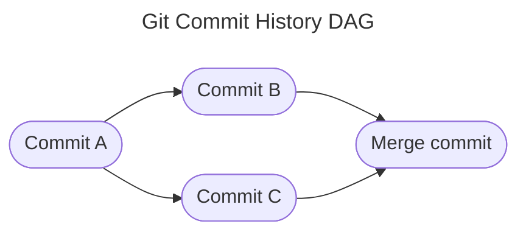

Commits point backward to their parent commits. When you open a [pull request](https://docs.github.com/en/pull-requests/reference/pull-requests) and [merge](https://en.wikipedia.org/wiki/Merge_(version_control)) a feature [branch](https://en.wikipedia.org/wiki/Branching_(version_control)) back to the `main` branch, two separate commit timelines merge into a single child commit. It's a multi-parent convergence, thus proving once again that Git [commit history](https://git-scm.com/book/en/v2/Git-Basics-Viewing-the-Commit-History) (and code merging) is a DAG.

> [!WARNING]
> The next section gets more technical. Feel free to skip. You have been warned 💀

## Group 4: Software + data engineering

### 4.1 Package / Module dependencies

When you install a package with `pip`, the [Python](https://www.python.org/) [package manager](https://en.wikipedia.org/wiki/Package_manager) resolves package dependencies and version constraints. A resolved dependency graph is often modeled as a DAG when its dependency relationships are acyclic, but package managers do more than traverse a graph.

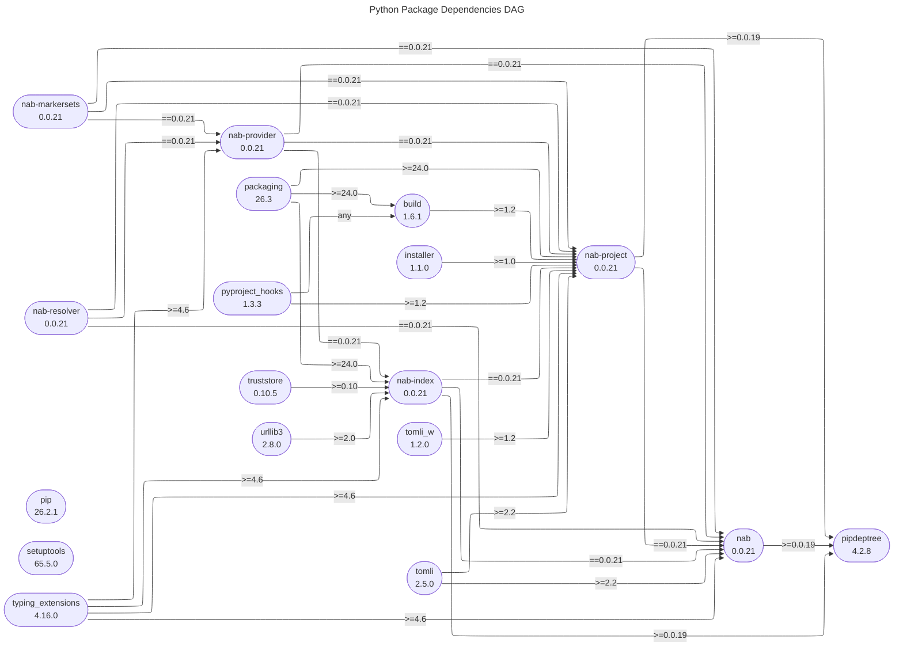

Your package might depend on other packages, which in turn depend on yet other packages. Package managers resolve these dependencies to make sure everything installs in the correct order without triggering version conflicts.

**Aside.** The Python Package Dependencies DAG above was created with [pipdeptree](https://pipdeptree.readthedocs.io/), with a bit of style modification. It is a command-line utility that can:

1. display installed Python packages as a dependency DAGs,
2. display [summary metrics](https://pipdeptree.readthedocs.io/en/latest/reference/cli.html#summary-metrics) of package dependencies, and
3. export the result to [JSON](https://en.wikipedia.org/wiki/JSON), [Mermaid](https://mermaid.js.org/) diagrams, or [Graphviz](https://graphviz.org/) graphs for further analysis.

> [!NOTE]
> Despite the name (pipdep-"tree"), the dependency result is a DAG instead of a tree, because a package may have > 1 parent, which violates the strict single-parent restriction of a tree. 

Here's a quick guide to using pipdeptree, tested with pipdeptree 4.2.8, Python 3.11.9, and macOS Tahoe 26.7.1.

```bash
# 1. Go to the home directory
cd ~

# 2. Create and go to pipdeptree directory
mkdir pipdeptree && cd pipdeptree

# 3. Create a virtual environment
python3.11 -m venv .venv

# 4. Activate the virtual environment
source .venv/bin/activate

# 5. Upgrade pip
pip3 install --upgrade pip

# 6. Install pipdeptree
pip3 install pipdeptree

# 7. View the full dependency DAG as rich text
pipdeptree --reverse

# 8. Export the full dependency DAG as mermaid diagram
pipdeptree --reverse -o mermaid > pipdeptree.mmd

# 9. View the summary metrics of package dependencies
pipdeptree --summary

# 10. Deactivate the virtual environment
deactivate
```

Summary metrics:

```text
                                           environment summary                                           
┏━━━━━━━━━━━━━━━━━━━━━━━━━━┳━━━━━━━━━━━━━━━━━━━━━━━━━━━━━━━━━━━━━━━━━━━━━━━━━━━━━━━━━━━━━━━━━━━━━━━━━━━━┓
┃ total packages           ┃ 18                                                                         ┃
┃ direct dependencies      ┃ 3                                                                          ┃
┃ transitive dependencies  ┃ 15                                                                         ┃
┃ max depth                ┃ 6                                                                          ┃
┃ cyclic dependencies      ┃ 0                                                                          ┃
┃ missing dependencies     ┃ 0                                                                          ┃
┃ conflicting dependencies ┃ 0 (0 edges)                                                                ┃
┃ licenses                 ┃ (Apache-2.0 OR BSD-2-Clause): 1, (MIT License): 2, (MIT): 14, (PSF-2.0): 1 ┃
┃ unknown licenses         ┃ 0                                                                          ┃
┃ copyleft licenses        ┃ no                                                                         ┃
┃ min requires-python      ┃ 3.11                                                                       ┃
┃ total size               ┃ 32.5 MB                                                                    ┃
┗━━━━━━━━━━━━━━━━━━━━━━━━━━┻━━━━━━━━━━━━━━━━━━━━━━━━━━━━━━━━━━━━━━━━━━━━━━━━━━━━━━━━━━━━━━━━━━━━━━━━━━━━┛
```

### 4.2 Dynamic programming

Once your packages are installed, it's time to develop the app. When solving heavy computational problems, [dynamic programming](https://en.wikipedia.org/wiki/Dynamic_programming) breaks a problem into smaller, [overlapping subproblems](https://en.wikipedia.org/wiki/Overlapping_subproblems) and reuses their result. Two common approaches are top-down ([memoization](https://www.w3schools.com/dsa/dsa_ref_memoization.php)) and bottom-up ([tabulation](https://www.w3schools.com/dsa/dsa_ref_tabulation.php)).

Let's see dynamic programming in action with the [Fibonacci sequence](https://en.wikipedia.org/wiki/Fibonacci_sequence). Here is a recursive naïve implementation and its [call stack](https://en.wikipedia.org/wiki/Call_stack).

```python
def fib(n: int) -> int:
	if n < 0: # Raise error early for invalid input
		raise ValueError(f"Input must be non-negative: n = {n}")
	elif n <= 1: # Finite base cases
		return n
	else: # Recursion
		return fib(n - 1) + fib(n - 2)

if __name__ == "__main__":
	print(fib(5)) # Output: 5
	print(fib(6)) # Output: 8
	print(fib(7)) # Output: 13
	print(fib(40)) # Output: 💀
```

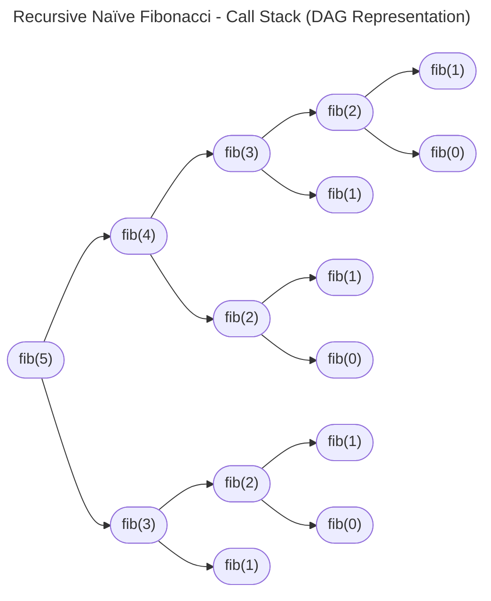

> [!NOTE]
> Check the animated call stack visualization here: https://recursion.vercel.app/

Here's the [complexity analysis](https://en.wikipedia.org/wiki/Analysis_of_algorithms) based on the call stack above:

|                                                                        | Complexity       | Why?                                  | Note                                  |
| ---------------------------------------------------------------------- | ---------------- | ------------------------------------- | ------------------------------------- |
| **[Time complexity](https://en.wikipedia.org/wiki/Time_complexity)**   | O(2<sup>n</sup>) | How many times the function is called | This is what kills the performance 💀 |
| **[Space complexity](https://en.wikipedia.org/wiki/Space_complexity)** | O(n)             | Max depth of the call stack           | It's okay I guess                     |

To fix this, we can use dynamic programming. Here are both the memoization and tabulation implementations.

```python
def fib_memo(n: int, memo: dict[int, int] | None = None) -> int:
	if n < 0: # Raise error early for invalid input
		raise ValueError(f"Input must be non-negative: n = {n}")
	if memo is None: # Pre-seed memo for finite base cases
		memo = {0: 0, 1: 1}
	if n not in memo: # Recurse only if input not in memo
		memo[n] = fib_memo(n - 1, memo) + fib_memo(n - 2, memo)
	return memo[n]

def fib_tab(n: int) -> int:
	if n < 0: # Raise error early for invalid input
		raise ValueError(f"Input must be non-negative: n = {n}")
	elif n <= 1: # Return early for finite base cases
		return n
	prev, curr = 0, 1 # Tabulate from the finite base cases to the input
	for _ in range(2, n + 1):
		prev, curr = curr, prev + curr
	return curr
```

When memoization caches previous calculations, it prunes the redundant branches of our recursive DAG, turning it into a clean linear chain.

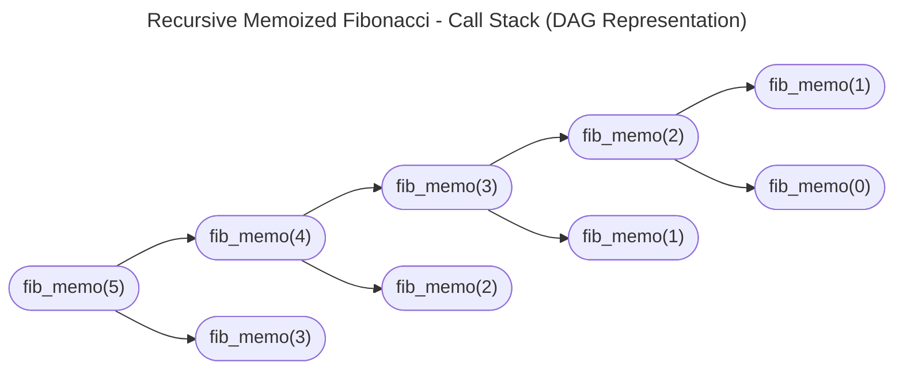

Meanwhile, tabulation avoids recursion and builds the answers iteratively from the base cases upward, moving step-by-step through a sequential dependency chain.

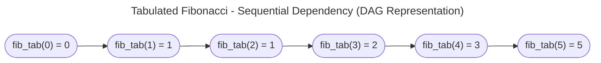

> [!NOTE]
> There are other implementations of the Fibonacci sequence using **fast doubling** and **matrix exponentiation**, but they are out of the scope of this article. Otherwise, this would turn into a dynamic programming article instead 💀

Here's how the approaches stack up against each other:

| Implementation            | Time complexity  | Space complexity | Within the scope of this article? |
| ------------------------- | ---------------- | ---------------- | --------------------------------- |
| **Recursive naïve**       | O(2<sup>n</sup>) | O(n)             | ✅                                 |
| **Recursive memoization** | O(n)             | O(n)             | ✅                                 |
| **Tabulation**            | O(n)             | O(1)             | ✅                                 |
| **Fast doubling**         | O(log n)         | O(log n)         | ❌                                 |
| **Matrix exponentiation** | O(log n)         | O(1)             | ❌                                 |

So you see, by representing overlapping subproblems as a DAG and reusing computed results, dynamic programming avoids repeated work over and over again, turning impossible computing tasks into very efficient solutions.

### 4.3 Build systems + ASTs

Once your code is written, how do you turn it into software? Compilers commonly parse source text into [Abstract Syntax Trees (ASTs)](https://en.wikipedia.org/wiki/Abstract_syntax_tree), which are trees. Separately, build tools model dependencies among source files, intermediate artifacts, and executables as graphs; when those dependencies are acyclic, the build graph is a DAG.

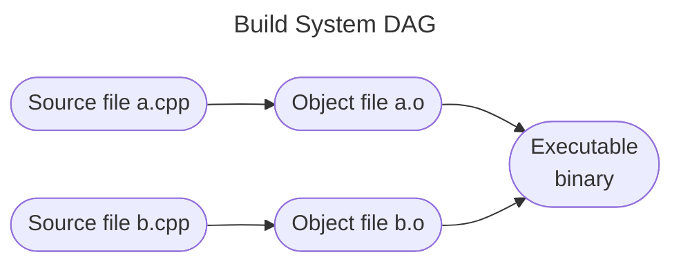

Build tools like [Make](https://people.cs.pitt.edu/~znati/Courses/CogNet/related/makeintro.html) or [Bazel](https://bazel.build/concepts/dependencies) use DAGs to figure out which files changed so they only recompile what is strictly necessary, saving developers from waiting hours for code to build.

### 4.4 Data warehouse

Once the app is built and running, it generates data, which can be used to produce [Business Intelligence (BI)](https://en.wikipedia.org/wiki/Business_intelligence). To do that, the data passes through three broad stages:

1. [**data ingestion**](https://www.getdbt.com/discover/understanding-data-ingestion) into a [Data Warehouse](https://en.wikipedia.org/wiki/Data_warehouse),
2. [**data transformation**](https://www.getdbt.com/blog/data-transformation) into a standard data model (such as [dimensional modeling](https://en.wikipedia.org/wiki/Dimensional_modeling), [data vault modeling](https://en.wikipedia.org/wiki/Data_vault_modeling), and [anchor modeling](https://en.wikipedia.org/wiki/Anchor_modeling)), and
3. [**data delivery**](https://www.getdbt.com/blog/reverse-etl-playbook) to downstream platforms (such as [BI tools](https://en.wikipedia.org/wiki/Business_intelligence_software), artificial intelligence models, or even back to the app).

[Data pipelines](https://www.ibm.com/think/topics/data-pipeline) manage these processes end-to-end. Many orchestration tools represent task dependencies as DAGs; [Apache Airflow](https://airflow.apache.org/docs/apache-airflow/stable/core-concepts/dags.html) is a well-known example.

Let's see it in action. Let's say we have a [customer-to-customer](https://en.wikipedia.org/wiki/Customer_to_customer) [e-commerce app](https://en.wikipedia.org/wiki/Types_of_e-commerce) with three operational tables: `customer`, `transaction`, and `product`. We want to analyze some metrics and feed the results back to the e-commerce app so that:

1. customers can see their purchase summaries and savings from discounts (up to the previous day), and
2. merchants can see product summaries and the most-purchased products (up to the previous day).

The overall data architecture looks like this. **This is not a DAG** because the data flows out of the **Data Warehouse** and loops back into the **App Database**, creating a closed operational cycle.

```mermaid
---
title: Data Flow Diagram
config:
    layout: elk
---
flowchart TD
    %% Nodes
    app([E-commerce app])
    subgraph oltp["Location: App Database (Data Source + Data Sink)"]
	    subgraph operation["Schema: operation"]
	        oltp-n1-1([customer])
	        oltp-n1-2([transaction])
	        oltp-n1-3([product])
        end
        subgraph analytic["Schema: analytic"]
	        oltp-n2-1([customer_\nmetrics])
	        oltp-n2-2([transaction_\nmetrics])
	        oltp-n2-3([product_\nmetrics])
        end
    end
    subgraph olap["Location: Data Warehouse (DWH)"]
	    subgraph ods["Layer: Operational Data Store (ODS)"]
	        olap-n1-1([ods_customer])
	        olap-n1-2([ods_transaction])
	        olap-n1-3([ods_product])
	    end
	    subgraph dim["Layer: Dimension (DIM)"]
	        olap-n2-1([dim_customer])
	        olap-n2-3([dim_product])
        end
        subgraph dwd["Layer: Data Warehouse Detail (DWD)"]
	        olap-n3-2([dwd_transaction])
	    end
	    subgraph dws["Layer: Data Warehouse Summary (DWS)"]
	        olap-n4-1([dws_customer_\ntransaction])
	        olap-n4-2([dws_transaction])
	        olap-n4-3([dws_product_\ntransaction])
        end
    end
    
    %% Edges
    app <-- read + write --> operation
    oltp-n1-1 -- i_ods_customer --> olap-n1-1
    oltp-n1-2 -- i_ods_transaction --> olap-n1-2
    oltp-n1-3 -- i_ods_product --> olap-n1-3
    olap-n1-1 -- t_dim_customer --> olap-n2-1
    olap-n1-3 -- t_dim_product --> olap-n2-3
    olap-n2-1 & olap-n1-2 & olap-n2-3 -- t_dwd_transaction --> olap-n3-2
    olap-n3-2 -- t_dws_customer_transaction --> olap-n4-1
    olap-n3-2 -- t_dws_transaction --> olap-n4-2
    olap-n3-2 -- t_dws_product_transaction --> olap-n4-3
    olap-n4-1 -- d_customer_metrics --> oltp-n2-1
    olap-n4-2 -- d_transaction_metrics --> oltp-n2-2
    olap-n4-3 -- d_product_metrics --> oltp-n2-3
    analytic -- read --> app
```

How to read the data flow diagram above:

1. Each node under **App Database** and **Data Warehouse** is a table. The Data Warehouse layers are based on a simplified version of [Alibaba Cloud's data model](https://www.alibabacloud.com/help/en/dataworks/user-guide/data-warehouse-layering):
	1. `ods_` prefix: Operational Data Store
	2. `dim_` prefix: Dimension
	3. `dwd_` prefix: Data Warehouse Detail
	4. `dws_` prefix: Data Warehouse Summary
2. Each edge is a process:
	1. `i_` prefix: Data ingestion
	2. `t_` prefix: Data transformation
	3. `d_` prefix: Data delivery

Notice that each process must run in the correct sequence; otherwise, a downstream process may run before an upstream process finishes, causing [data quality](https://www.ibm.com/think/topics/data-quality-dimensions) issues.

To keep the scheduled work acyclic while preserving dependencies, we can represent ingestion, transformation, and delivery as separate DAGs, then coordinate their dependencies across the pipeline.

```mermaid
---
title: Data Pipeline Multi-DAGs
config:
    layout: elk
---
flowchart LR
    %% Nodes
    subgraph ingest["DAG: Data Ingestion"]
	    ingest-n1-1([i_ods_customer])
	    ingest-n1-2([i_ods_transaction])
	    ingest-n1-3([i_ods_product])
    end
    subgraph transform["DAG: Data Transformation"]
	    transform-n1-1([t_dim_customer])
	    transform-n1-3([t_dim_product])
	    transform-n2-2([t_dwd_\ntransaction])
	    transform-n3-1([t_dws_custo\nmer_transaction])
	    transform-n3-2([t_dws_\ntransaction])
	    transform-n3-3([t_dws_produ\nct_transaction])
    end
    subgraph deliver["DAG: Data Delivery"]
	    deliver-n1-1([d_customer_\nmetrics])
	    deliver-n1-2([d_transaction_\nmetrics])
	    deliver-n1-3([d_product_\nmetrics])
    end
    
    %% Edges
    ingest-n1-1 --> transform-n1-1
    ingest-n1-3 --> transform-n1-3
    transform-n1-1 & ingest-n1-2 & transform-n1-3 --> transform-n2-2
    transform-n2-2 --> transform-n3-1 & transform-n3-2 & transform-n3-3
    transform-n3-1 --> deliver-n1-1
    transform-n3-2 --> deliver-n1-2
    transform-n3-3 --> deliver-n1-3
```

 Here's the description of each table, as well as the process that generates it.

| Table name                   | Location       | Schema / Layer | Granularity                   | Created by process         | DAG                 | Description                                                                                                                                                                                                          |
| ---------------------------- | -------------- | -------------- | ----------------------------- | -------------------------- | ------------------- | -------------------------------------------------------------------------------------------------------------------------------------------------------------------------------------------------------------------- |
| 1. customer                  | App Database   | operation      | customer_id                   | Write from E-commerce app  | Not applicable      | Operational table used by the E-commerce app                                                                                                                                                                         |
| 2. transaction               | App Database   | operation      | transaction_id                | Write from E-commerce app  | Not applicable      | Operational table used by the E-commerce app                                                                                                                                                                         |
| 3. product                   | App Database   | operation      | product_id                    | Write from E-commerce app  | Not applicable      | Operational table used by the E-commerce app                                                                                                                                                                         |
| 4. ods_customer              | Data Warehouse | ODS            | customer_id × ingestion_ts    | i_ods_customer             | Data Ingestion      | Batch ingestion of `customer` table from the App Database                                                                                                                                                            |
| 5. ods_transaction           | Data Warehouse | ODS            | transaction_id × ingestion_ts | i_ods_transaction          | Data Ingestion      | Batch ingestion of `transaction` table from the App Database                                                                                                                                                         |
| 6. ods_product               | Data Warehouse | ODS            | product_id × ingestion_ts     | i_ods_product              | Data Ingestion      | Batch ingestion of `product` table from the App Database                                                                                                                                                             |
| 7. dim_customer              | Data Warehouse | DIM            | customer_id × start_ts        | t_dim_customer             | Data Transformation | Cleans (deduplicates and standardizes data types, enums, etc.) `ods_customer`, and implements [slowly changing dimension (SCD)](https://en.wikipedia.org/wiki/Slowly_changing_dimension) to track historical changes |
| 8. dwd_transaction           | Data Warehouse | DWD            | transaction_id                | t_dwd_transaction          | Data Transformation | Cleans `ods_transaction`, and enriches it with customer and product info from `dim_customer` and `dim_product`, respectively                                                                                         |
| 9. dim_product               | Data Warehouse | DIM            | product_id × start_ts         | t_dim_product              | Data Transformation | Cleans `ods_product`, and implements SCD to track historical changes                                                                                                                                                 |
| 10. dws_customer_transaction | Data Warehouse | DWS            | customer_id × date            | t_dws_customer_transaction | Data Transformation | Calculates customer-level metrics from transactions (e.g., purchase summary, savings from discounts)                                                                                                                 |
| 11. dws_transaction          | Data Warehouse | DWS            | date                          | t_dws_transaction          | Data Transformation | Calculates transaction-level metrics (e.g., [gross merchandise value (GMV)](https://www.investopedia.com/terms/g/gross-merchandise-value.asp), revenue)                                                              |
| 12. dws_product_transaction  | Data Warehouse | DWS            | product_id × date             | t_dws_product_transaction  | Data Transformation | Calculates product-level metrics from transactions (e.g., product summary, most purchased products)                                                                                                                  |
| 13. customer_metrics         | App Database   | analytic       | customer_id × date            | d_customer_metrics         | Data Delivery       | Analytical table used by the E-commerce app, calculated in `dws_customer_transaction`                                                                                                                                |
| 14. transaction_metrics      | App Database   | analytic       | date                          | d_transaction_metrics      | Data Delivery       | Analytical table used by the E-commerce app, calculated in `dws_transaction`                                                                                                                                         |
| 15. product_metrics          | App Database   | analytic       | product_id × date             | d_product_metrics          | Data Delivery       | Analytical table used by the E-commerce app, calculated in `dws_product_transaction`                                                                                                                                 |

Data flows downstream from ingestion through transformation to delivery. If a task fails upstream, downstream tasks will not proceed to prevent corrupted data from ruining everyone's metrics.

### 4.5 Query execution plans

Underneath those data pipelines, when you write an SQL query (like the ones powering our `t_dwd_transaction` transformation process), your database doesn't just execute it blindly. It builds a [query execution plan](https://en.wikipedia.org/wiki/Query_plan).

```mermaid
---
title: Simplified Query Execution Plan for t_dwd_transaction
config:
    layout: dagre
---
flowchart LR
    n1-1([Table scan:\ndim_customer])
    n1-2([Table scan:\nods_transaction])
    n1-3([Table scan:\ndim_product])
    n2-2([Filter:\nTransactions on\nprevious day])
    n3-1([Hash join:\ncustomer\n+ transactions])
    n3-2([Hash join:\n+ product])
    n4-1([Sort])

    n1-2 --> n2-2
    n1-1 & n2-2 --> n3-1
    n3-1 & n1-3 --> n3-2
    n3-2 --> n4-1
```

The database optimizer acts like an obsessively thorough project manager, rearranging relational operators into an efficient DAG. It scans tables, applies filters, joins datasets, and sorts rows along optimized paths to return your results in seconds instead of hours.

> [!NOTE]
> On [PostgreSQL](https://www.postgresql.org/docs/current/sql-explain.html), use `EXPLAIN` and `EXPLAIN ANALYZE` to inspect your query execution plan (or just stare at it in absolute horror when a missing index turns your query into a full table scan that melts your database 💀).

### 4.6 Causal inference + confounding variables

When data scientists analyze data, they don't just want to know if two things happen together ([correlation](https://en.wikipedia.org/wiki/Correlation)). They want to know if one thing actually **causes** the other (causation). To do this without accidentally ruining science, researchers use causal DAGs to map out [confounding variables](https://book.the-turing-way.org/project-design/risks-of-bias/confounding-variables/).

> [!NOTE]
> [Correlation does not imply causation](https://en.wikipedia.org/wiki/Correlation_does_not_imply_causation). 

A **confounder** is a sneaky third factor that affects both your cause (**exposure**) and your effect (**outcome**), making it look like a direct relationship exists when it's actually an illusion.

Let's look at a classic statistical trap: does coffee habit cause heart disease? 

```mermaid
---
title: The Confounding Variable DAG
config:
    layout: dagre
---
flowchart LR
    %% Nodes
    n1-1([🌪️\nStress / Lifestyle])
    n2-1([☕\nCoffee habit])
    n2-2([🚬\nSmoking habit])
    n3-1([🫀\nHeart disease])
    
    %% Edges
    n1-1 --> n2-1 & n2-2
    n2-1 & n2-2 --> n3-1
```

Here is the role of each variable in this graph:

| Node                  | Role        | Note                                                                                                                                      |
| --------------------- | ----------- | ----------------------------------------------------------------------------------------------------------------------------------------- |
| 1. Coffee habit       | Exposure    | The variable you are testing to see if it causes harm                                                                                     |
| 2. Heart disease      | Outcome     | The final medical result you are measuring                                                                                                |
| 3. Stress / Lifestyle | Confounder  | Influences coffee habits and, through smoking in this simplified graph, heart disease risk                                                |
| 4. Smoking habit      | Risk factor | Causes heart disease and lies on the path from stress / lifestyle to the outcome; it is not a confounder of coffee's effect in this graph |

If you fail to map your data as a DAG and control for these variables, your statistical model will look at the data, see that coffee drinkers have higher rates of heart disease, and confidently blame your innocent morning brew. In reality, smoking and stress were doing all the damage all along, proving once again that numbers will happily lie to you if you don't trace their directions.

> [!NOTE]
> In causal inference, drawing the wrong DAG can lead to [**collider bias**](https://catalogofbias.org/biases/collider-bias/) or [**overadjustment bias**](https://pmc.ncbi.nlm.nih.gov/articles/PMC2744485/), fancy terms for accidentally breaking your own analysis because you forgot how arrows point 💀

### 4.7 DAG-based cryptocurrencies

Moving beyond traditional databases, some distributed-ledger designs use DAGs rather than relying only on a single linear chain. IOTA's original [Tangle](https://en.wikipedia.org/wiki/IOTA_(technology)) is a well-known example, though IOTA substantially changed its mainnet protocol with the [Rebased upgrade in May 2025](https://blog.iota.org/rebased-mainnet-upgrade/).

```mermaid
---
title: Cryptocurrency DAG (Tangle)
config:
    layout: dagre
---
flowchart LR
    n1-1([Tx 1])
    n1-2([Tx 2])
    n1-3([Tx 3])
    n2-1([New Tx 4])

    n1-1 & n1-2 & n1-3 --> n2-1
```

In the classic Tangle design, each new transaction approves two earlier transactions. That rule is specific to that design, not a universal property of DAG-based ledgers. A DAG can support more parallel processing, but fee levels, mining or validator roles, and confirmation rules depend on the protocol, not on the graph structure alone.

Further reading:

1. [DagCoin Draft](https://bitslog.com/wp-content/uploads/2015/09/dagcoin-v41.pdf)
2. [Directed Acyclic Graph Based Blockchain Systems](https://arxiv.org/pdf/2312.09816)
3. [Top Directed Acyclic Graph (DAG) Coins by Market Cap](https://www.coingecko.com/en/categories/directed-acyclic-graph-dag)

## Um, so what can I do with this information?

Now that you've reached the end of this rabbit hole, you'll probably start seeing DAGs everywhere (like I do 💀).

When your project manager assigns a chaotic list of tasks, when you're untangling messy code dependencies, or even when you're cooking dinner, you may recognize a web of directed, cycle-free dependencies. Or DAGs, if you will.

Not everything is literally a DAG, and real systems can contain feedback loops. But DAGs are a useful way to model the parts where direction and dependency matter. So embrace the DAG, keep your dependencies clean, and may your pipelines never fail! 🚀