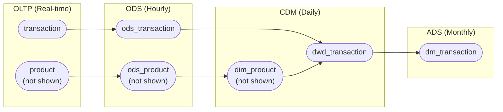

# 2026-10-22 PostgreSQL Timestamp Range and GiST Indexes

By [Vincentius Timothy](https://registry.jsonresume.org/vincentimo).

<!-- toc-gitlab:start mode=full -->
## Contents<br>
1. [Use case](#use-case)
2. [Data ingestion (hourly)](#data-ingestion-hourly)
3. [Data transformation (daily)](#data-transformation-daily)
4. [Data transformation (monthly)](#data-transformation-monthly)
5. [References](#references)
<!-- toc-gitlab:end -->

## Use case



## Data ingestion (hourly)

Airflow DAG:

```json
{
    "dag_id": "INGEST_PSQL_BATCH_H_00",
    "schedule": "0 * * * *",
    "start_date": "2026-01-01 00:00:00",
    "catchup": True
}
```

DDL:

```sql
CREATE TABLE IF NOT EXISTS ods.ods_transaction (
    _data_tstzrange TSTZRANGE,
    _committed_tstz TIMESTAMPTZ,
    id BIGINT,
    product_id BIGINT,
    gtv NUMERIC,
    ...
);

CREATE INDEX idx_ods_transaction_data_tstzrange ON ods.ods_transaction USING GIST (_data_tstzrange);
CREATE INDEX idx_ods_transaction_committed_tstz ON ods.ods_transaction USING BTREE (_committed_tstz DESC);
```

DQL:

```sql
SELECT
    TSTZRANGE('{{ env_var("data_interval_start") }}'::TIMESTAMPTZ,
              '{{ env_var("data_interval_end") }}'::TIMESTAMPTZ, '[)') AS _data_tstzrange,
    NOW() AS _committed_tstz,
    id,
    product_id,
    gtv,
    ...
FROM
    transaction
WHERE
    (created_tstz >= '{{ env_var("data_interval_start") }}'::TIMESTAMPTZ
    AND created_tstz < '{{ env_var("data_interval_end") }}'::TIMESTAMPTZ)
    OR (updated_tstz >= '{{ env_var("data_interval_start") }}'::TIMESTAMPTZ
    AND updated_tstz < '{{ env_var("data_interval_end") }}'::TIMESTAMPTZ);
```

## Data transformation (daily)

Airflow DAG:

```json
{
    "dag_id": "TRANSFORM_CDM_D_0300",
    "schedule": "0 3 * * *",
    "start_date": "2026-01-01 03:00:00",
    "catchup": True
}
```

DDL:

```sql
CREATE TABLE IF NOT EXISTS dwd.dwd_transaction (
    _data_tstzrange TSTZRANGE,
    _committed_tstz TIMESTAMPTZ,
    id BIGINT PRIMARY KEY,
    product_id BIGINT,
    product_category TEXT,
    gtv NUMERIC,
    ...
);

CREATE INDEX idx_dwd_transaction_data_tstzrange ON dwd.dwd_transaction USING GIST (_data_tstzrange);
CREATE INDEX idx_dwd_transaction_committed_tstz ON dwd.dwd_transaction USING BTREE (_committed_tstz DESC);
```

DQL:

```sql
SELECT
    TSTZRANGE(DATE_TRUNC('DAY', '{{ env_var("data_interval_start") }}'::TIMESTAMPTZ),
              DATE_TRUNC('DAY', '{{ env_var("data_interval_end") }}'::TIMESTAMPTZ), '[)') AS _data_tstzrange,
    NOW() AS _committed_tstz,
    t.id,
    t.product_id,
    p.product_category,
    t.gtv,
    ...
FROM
    ods.ods_transaction AS t
LEFT JOIN
    dim.dim_product AS p
ON
    t.product_id = p.id
WHERE
    t._data_tstzrange &&
        TSTZRANGE(DATE_TRUNC('DAY', '{{ env_var("data_interval_start") }}'::TIMESTAMPTZ),
                  DATE_TRUNC('DAY', '{{ env_var("data_interval_end") }}'::TIMESTAMPTZ), '[)');
```

## Data transformation (monthly)

Airflow DAG:

```json
{
    "dag_id": "TRANSFORM_ADS_M_01_0600",
    "schedule": "0 6 1 * *",
    "start_date": "2026-01-01 06:00:00",
    "catchup": True
}
```

DDL:

```sql
CREATE TABLE IF NOT EXISTS dm.dm_transaction (
    _data_tstzrange TSTZRANGE,
    _committed_tstz TIMESTAMPTZ,
    snapshot_date DATE,
    product_category TEXT,
    cnt BIGINT,
    gtv NUMERIC,
    ...,
    PRIMARY KEY (snapshot_date, product_category)
);

CREATE INDEX idx_dm_transaction_data_tstzrange ON dm.dm_transaction USING GIST (_data_tstzrange);
CREATE INDEX idx_dm_transaction_committed_tstz ON dm.dm_transaction USING BTREE (_committed_tstz DESC);
```

DQL:

```sql
WITH
    dm_transaction AS (
        SELECT
            DATE_TRUNC('MONTH', '{{ env_var("data_interval_start") }}'::TIMESTAMPTZ) AS snapshot_date,
            product_category,
            COUNT(1) AS cnt,
            SUM(gtv) AS gtv,
            ...
        FROM
            dwd.dwd_transaction
        WHERE
            _data_tstzrange &&
                TSTZRANGE(DATE_TRUNC('MONTH', '{{ env_var("data_interval_start") }}'::TIMESTAMPTZ),
                          DATE_TRUNC('MONTH', '{{ env_var("data_interval_end") }}'::TIMESTAMPTZ), '[)')
        GROUP BY
            snapshot_date,
            product_category
    )
SELECT
    TSTZRANGE(DATE_TRUNC('MONTH', '{{ env_var("data_interval_start") }}'::TIMESTAMPTZ),
              DATE_TRUNC('MONTH', '{{ env_var("data_interval_end") }}'::TIMESTAMPTZ), '[)') AS _data_tstzrange,
    NOW() AS _committed_tstz,
    snapshot_date,
    product_category,
    cnt,
    gtv,
    ...
FROM
    dm_transaction;
```

## References

1. https://oneuptime.com/blog/post/2026-01-30-postgresql-range-types/view
2. https://boringsql.com/posts/beyond-start-end-columns/
3. https://medium.com/dataseries/range-types-in-postgresql-and-gist-indexes-788db23346c5
4. https://www.postgresql.org/docs/current/rangetypes.html
5. https://www.postgresql.org/docs/current/functions-range.html
6. https://www.postgresql.org/docs/current/gist.html
7. https://www.alibabacloud.com/help/en/dataworks/user-guide/data-warehouse-layering