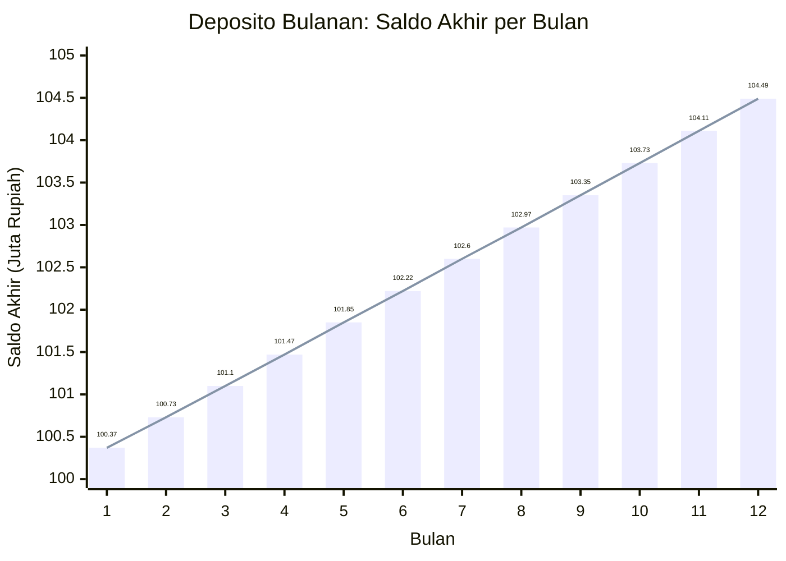
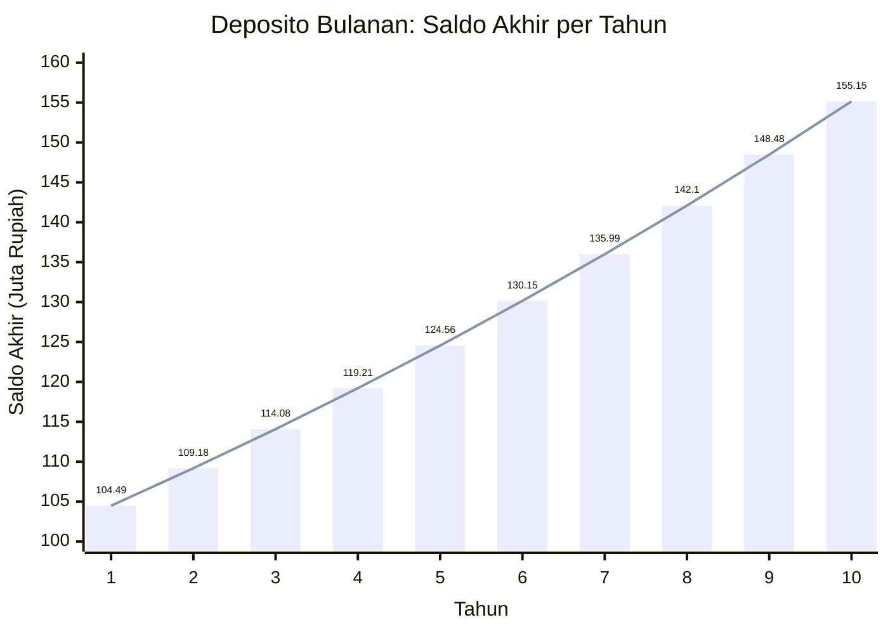
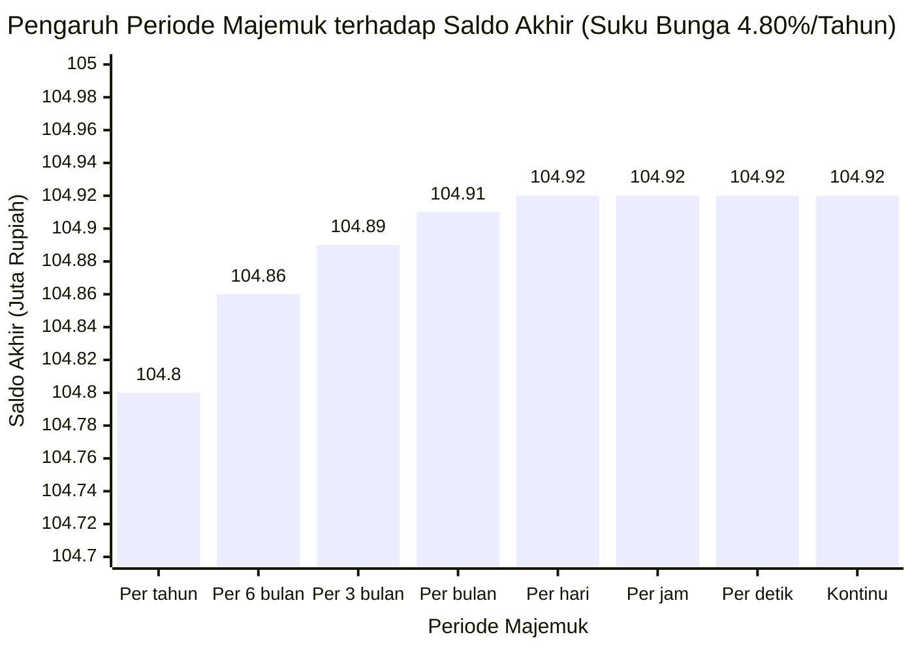
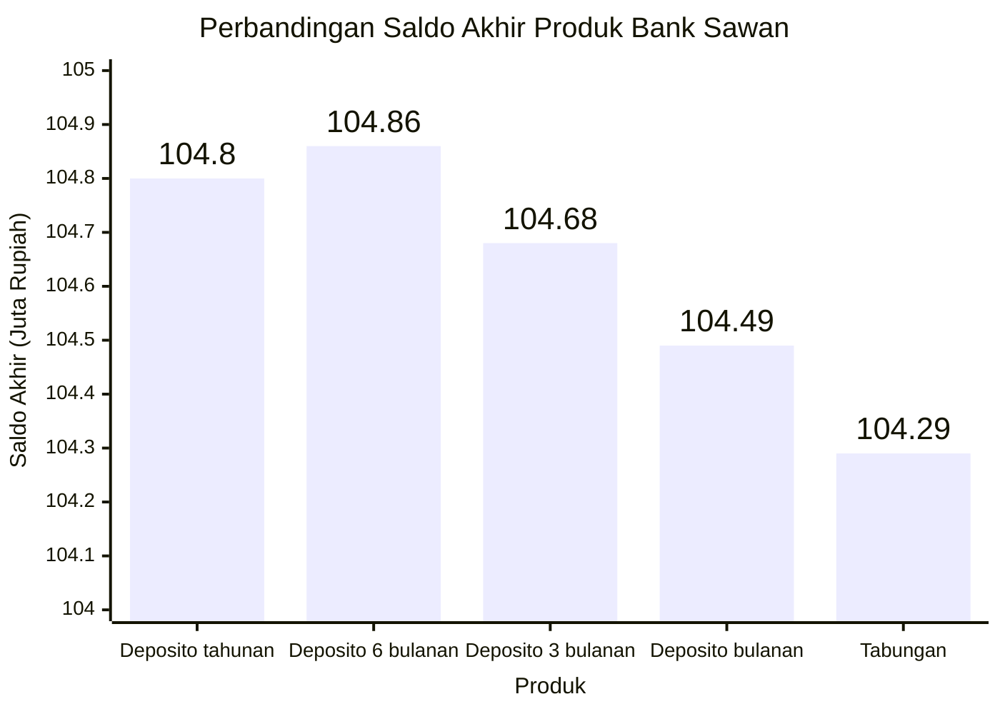

# 2026-10-25 Deposito vs Tabungan - Perbandingan Bunga Majemuk

Oleh [Vincentius Timothy](https://registry.jsonresume.org/vincentimo).

Misal kamu memiliki [uang dingin](https://pegadaian.co.id/artikel/keuangan/uang-dingin-adalah) $\text{Rp}100.000.000,00$, yang sudah pasti tidak akan digunakan dalam 1 tahun ke depan. Kamu ingin uangnya bertumbuh, namun [tidak ingin mengambil risiko tinggi](https://pegadaian.co.id/artikel/berita/tipe-investor-berdasarkan-profil-risiko), sehingga kamu mencari opsi investasi deposito atau tabungan.

Bank Sawan menawarkan beberapa produk. Namun, mana yang sebaiknya kamu pilih?

| Produk   | Periode bunga majemuk (Tenor deposito) | Suku bunga tahunan (sebelum pajak $20％$) | Suku bunga tahunan (setelah pajak $20％$) |
| -------- | ----------------------------------------- | :-----------------------------------------: | :-----------------------------------------: |
| Deposito | Tahunan                                   |                   $6,00％$                   |                   $4,80％$                   |
| Deposito | 6 bulanan                                 |                   $6,00％$                   |                   $4,80％$                   |
| Deposito | 3 bulanan                                 |                   $5,75％$                   |                   $4,60％$                   |
| Deposito | Bulanan                                   |                   $5,50％$                   |                   $4,40％$                   |
| Tabungan | Kontinu                                   |                   $5,25％$                   |                   $4,20％$                   |

> [!NOTE]
> Deposito tahunan dan 6 bulanan memang memiliki suku bunga tahunan yang sama di $4,80％$ (setelah pajak).

<!-- toc-gitlab:start mode=full -->
## Contents 
1. [Deposito bulanan](#deposito-bulanan)
	1. [Berapa saldo di akhir bulan ke-1?](#berapa-saldo-di-akhir-bulan-ke-1)
	2. [Berapa saldo di akhir bulan ke-2?](#berapa-saldo-di-akhir-bulan-ke-2)
	3. [Berapa saldo di akhir 1 tahun (bulan ke-12)?](#berapa-saldo-di-akhir-1-tahun-bulan-ke-12)
	4. [Berapa saldo di akhir setiap bulan?](#berapa-saldo-di-akhir-setiap-bulan)
2. [Deposito lainnya](#deposito-lainnya)
3. [Tabungan](#tabungan)
4. [Produk mana yang sebaiknya kamu pilih?](#produk-mana-yang-sebaiknya-kamu-pilih)
5. [Lampiran: Penjelasan formula](#lampiran-penjelasan-formula)
	1. [Daftar simbol](#daftar-simbol)
	2. [Suku bunga 1 periode](#suku-bunga-1-periode)
	3. [Bunga di akhir periode ke-1](#bunga-di-akhir-periode-ke-1)
	4. [Saldo di akhir periode ke-1](#saldo-di-akhir-periode-ke-1)
	5. [Bunga di akhir periode ke-2](#bunga-di-akhir-periode-ke-2)
	6. [Saldo di akhir periode ke-2](#saldo-di-akhir-periode-ke-2)
	7. [Saldo di akhir periode ke-*t*](#saldo-di-akhir-periode-ke-t)
	8. [Bunga di akhir periode ke-*t*](#bunga-di-akhir-periode-ke-t)
	9. [Total bunga sampai akhir periode ke-*t*](#total-bunga-sampai-akhir-periode-ke-t)
	10. [Suku bunga efektif sampai akhir periode ke-*t*](#suku-bunga-efektif-sampai-akhir-periode-ke-t)
	11. [Saldo akhir untuk proses majemuk kontinu](#saldo-akhir-untuk-proses-majemuk-kontinu)
	12. [Total bunga untuk proses majemuk kontinu](#total-bunga-untuk-proses-majemuk-kontinu)
	13. [Suku bunga efektif untuk proses majemuk kontinu](#suku-bunga-efektif-untuk-proses-majemuk-kontinu)
	14. [Ringkasan](#ringkasan)
<!-- toc-gitlab:end -->

## Deposito bulanan

### Berapa saldo di akhir bulan ke-1?

**Misal kamu memilih deposito bulanan (suku bunga $4,40％$ setelah pajak). Berapa saldo di akhir bulan ke-1?**

> [!NOTE]
> * Bank Sawan melihat 1 bulan = 30 hari dan 1 tahun = 360 hari, agar lebih sederhana.
> * Namun, biasanya bank melihat banyak hari sebenarnya dalam 1 bulan dan 1 tahun. 
> * Penyebutan "suku bunga" di bagian ini dan seterusnya adalah suku bunga setelah pajak.

Suku bunga 1 bulan:

$$\cfrac{4,40％}{\cfrac{360}{30}}=0,3\overline{6}％$$

Bunga di akhir bulan ke-1:

$$\text{Rp}100.000.000,00\times0,3\overline{6}％=\text{Rp}366.666,67$$

Saldo di akhir bulan ke-1:

$$\text{Rp}100.000.000,00+\text{Rp}366.666,67=\text{Rp}100.366.666,67$$

### Berapa saldo di akhir bulan ke-2?

**Misal kamu memperpanjang depositonya. Berapa saldo di akhir bulan ke-1?**

Bunga di akhir bulan ke-2:

$$\text{Rp}100.366.666,67\times0,3\overline{6}％=\text{Rp}368.011,11$$

Saldo di akhir bulan ke-2:

$$\text{Rp}100.366.666,67+\text{Rp}368.011,11=\text{Rp}100.734.677,78$$

> [!NOTE]
> * Perhatikan bahwa saldo di akhir bulan ke-2 ($\text{Rp}368.011,11$) lebih tinggi daripada di akhir bulan ke-1 ($\text{Rp}366.666,67$).
> * **Semakin lama, bunga yang kamu terima semakin tinggi**, karena bunga di akhir bulan ke-1 berbunga lagi di bulan ke-2.
> * Inilah [keajaiban bunga majemuk](https://monely.app/blog/id/bunga-majemuk-keajaiban-dunia-ke-8-dalam-praktik/).

### Berapa saldo di akhir 1 tahun (bulan ke-12)?

**Misal kamu memperpanjang depositonya lagi sampai 1 tahun. Berapa saldo akhirnya?**

Sebenarnya, kita bisa saja menghitung saldo di akhir 1 tahun dengan cara yang sama. Namun, prosesnya memakan banyak waktu. **Agar lebih cepat, kita akan menggunakan formula.**

Saldo di akhir periode ke- $t$:

$$P_t=P_0\left(1+\cfrac{r}{n}\right)^t$$

di mana:

| Simbol | Deskripsi                      | Contoh nilai              |
| ------ | ------------------------------ | ------------------------- |
| $r$    | Suku bunga tahunan             | $4,40％$                   |
| $n$    | Berapa kali dalam 1 tahun?     | $\cfrac{360}{30}=12$      |
| $t$    | Periode keberapa?              | $12$                      |
| $P_0$  | Saldo awal (Pokok)             | $\text{Rp}100.000.000,00$ |
| $P_1$  | Saldo di akhir periode ke-1    | $\text{Rp}100.366.666,67$ |
| $P_t$  | Saldo di akhir periode ke- $t$ | $\text{Rp}104.489.826,85$ |

> [!NOTE]
> **Formulanya dapat dari mana?** Tenang, penjelasannya ada di bawah. Namun, lumayan teknis, tidak apa-apa di-*skip*.

Sekarang, mari kita hitung ulang saldo di akhir bulan ke-1 dan bulan ke-2 dengan formula ini.

Saldo di akhir bulan ke-1:

$$\begin{align}
P_1 &= P_0\left(1+\cfrac{r}{n}\right)^1 \\
&= \text{Rp}100.000.000,00\times\left(1+\cfrac{4,40％}{\cfrac{360}{30}}\right)^1 \\
&= \text{Rp}100.366.666,67
\end{align}$$

dan saldo di akhir bulan ke-2:

$$\begin{align}
P_2 &= P_0\left(1+\cfrac{r}{n}\right)^1 \\
&= \text{Rp}100.000.000,00\times\left(1+\cfrac{4,40％}{\cfrac{360}{30}}\right)^2 \\
&= \text{Rp}100.734.677,78
\end{align}$$

Hasilnya cocok dengan perhitungan sebelumnya. Oleh karena itu, kita akan menggunakan formula ini untuk menghitung saldo di akhir bulan ke-12:

$$\begin{align}
P_{12} &= P_0\left(1+\cfrac{r}{n}\right)^1 \\
&= \text{Rp}100.000.000,00\times\left(1+\cfrac{4,40％}{\cfrac{360}{30}}\right)^{12} \\
&= \text{Rp}104.489.826,85
\end{align}$$

### Berapa saldo di akhir setiap bulan?

Dengan cara yang sama, kita bisa mendapatkan saldo akhir setiap bulan.

| Bulan | Saldo awal                | Saldo akhir               | Bunga (Saldo akhir - Saldo awal) |
| ----- | ------------------------- | ------------------------- | ----------------------------------- |
| 1     | $\text{Rp}100.000.000,00$ | $\text{Rp}100.366.666,67$ | $\text{Rp}366.666,67$               |
| 2     | $\text{Rp}100.366.666,67$ | $\text{Rp}100.734.677,78$ | $\text{Rp}368.011,11$               |
| 3     | $\text{Rp}100.734.677,78$ | $\text{Rp}101.104.038,26$ | $\text{Rp}369.360,49$               |
| 4     | $\text{Rp}101.104.038,26$ | $\text{Rp}101.474.753,07$ | $\text{Rp}370.714,81$               |
| 5     | $\text{Rp}101.474.753,07$ | $\text{Rp}101.846.827,16$ | $\text{Rp}372.074,09$               |
| 6     | $\text{Rp}101.846.827,16$ | $\text{Rp}102.220.265,53$ | $\text{Rp}373.438,37$               |
| 7     | $\text{Rp}102.220.265,53$ | $\text{Rp}102.595.073,17$ | $\text{Rp}374.807,64$               |
| 8     | $\text{Rp}102.595.073,17$ | $\text{Rp}102.971.255,11$ | $\text{Rp}376.181,93$               |
| 9     | $\text{Rp}102.971.255,11$ | $\text{Rp}103.348.816,37$ | $\text{Rp}377.561,27$               |
| 10    | $\text{Rp}103.348.816,37$ | $\text{Rp}103.727.762,03$ | $\text{Rp}378.945,66$               |
| 11    | $\text{Rp}103.727.762,03$ | $\text{Rp}104.108.097,16$ | $\text{Rp}380.335,13$               |
| 12    | $\text{Rp}104.108.097,16$ | $\text{Rp}104.489.826,85$ | $\text{Rp}381.729,69$               |

```mermaid
xychart
    title "Deposito Bulanan: Bunga per Bulan"
    x-axis "Bulan" 1 --> 12
    y-axis "Bunga (Ribu Rupiah)" 0 --> 4500
    bar "Bunga Kumulatif" [366.67, 734.68, 1104.04, 1474.75, 1846.83, 2220.27, 2595.07, 2971.26, 3348.82, 3727.76, 4108.10, 4489.83]
    line [366.67, 734.68, 1104.04, 1474.75, 1846.83, 2220.27, 2595.07, 2971.26, 3348.82, 3727.76, 4108.10, 4489.83]
    bar "Bunga" [366.67, 368.01, 369.36, 370.71, 372.07, 373.44, 374.81, 376.18, 377.56, 378.95, 380.34, 381.73]
    line [366.67, 368.01, 369.36, 370.71, 372.07, 373.44, 374.81, 376.18, 377.56, 378.95, 380.34, 381.73]
```

Saldo akhir dan bunga akan [tumbuh secara eksponensial](https://id.wikipedia.org/wiki/Pertumbuhan_eksponensial). Mungkin akan lebih jelas jika depositonya diperpanjang terus sampai 10 tahun.

```mermaid
xychart
    title "Deposito Bulanan: Bunga per Tahun"
    x-axis "Tahun" 1 --> 10
    y-axis "Bunga (Juta Rupiah)" 0 --> 56
    bar "Bunga Kumulatif" [4.49, 9.18, 14.08, 19.21, 24.56, 30.15, 35.99, 42.10, 48.48, 55.15]
    line [4.49, 9.18, 14.08, 19.21, 24.56, 30.15, 35.99, 42.10, 48.48, 55.15]
    bar "Bunga" [4.49, 4.69, 4.90, 5.12, 5.35, 5.59, 5.84, 6.11, 6.38, 6.67]
    line [4.49, 4.69, 4.90, 5.12, 5.35, 5.59, 5.84, 6.11, 6.38, 6.67]
```

## Deposito lainnya

Sekarang, kita sudah bisa menghitung saldo di akhir 1 tahun untuk deposito lainnya. **Bedanya adalah definisi periodenya.**

- Untuk deposito bulanan (di contoh sebelumnya): 1 periode = 1 bulan, dan 1 tahun = 12 periode. Oleh karena itu, kita menghitung $P_{12}$.
- Untuk deposito 3 bulanan: 1 periode = 3 bulan, dan 1 tahun = 4 periode. Oleh karena itu, kita menghitung $P_4$.
- Untuk deposito 6 bulanan: 1 periode = 6 bulan, dan 1 tahun = 2 periode. Oleh karena itu, kita menghitung $P_2$.
- Untuk deposito tahunan: 1 periode = 1 tahun, dan 1 tahun = 1 periode. Oleh karena itu, kita menghitung $P_1$.

Mari kita bandingkan.

| Simbol | Deskripsi                      | Deposito bulanan                 | Deposito 3 bulanan              | Deposito 6 bulanan              | Deposito tahunan                |
| ------ | ------------------------------ | -------------------------------- | ------------------------------- | ------------------------------- | ------------------------------- |
| $r$    | Suku bunga tahunan             | $4,40％$                          | $4,60％$                         | $4,80％$                         | $4,80％$                         |
| $n$    | Berapa kali dalam 1 tahun?     | $\cfrac{360}{30}=12$             | $\cfrac{360}{90}=4$             | $\cfrac{360}{180}=2$            | $\cfrac{360}{360}=1$            |
| $t$    | Periode keberapa?              | $12$                             | $4$                             | $2$                             | $1$                             |
| $P_0$  | Saldo awal (Pokok)             | $\text{Rp}100.000.000,00$        | $\text{Rp}100.000.000,00$       | $\text{Rp}100.000.000,00$       | $\text{Rp}100.000.000,00$       |
| $P_t$  | Saldo di akhir periode ke- $t$ | $P_{12}=\text{Rp}104.489.826,85$ | $P_{4}=\text{Rp}104.679.960,10$ | $P_{2}=\text{Rp}104.857.600,00$ | $P_{1}=\text{Rp}104.800.000,00$ |

> [!NOTE]
> Sejauh ini, produk yang paling menguntungkan adalah deposito 6 bulanan.

Tapi, bagaimana jika dibandingkan dengan tabungan, yang proses majemuknya kontinu? Apa pula itu majemuk kontinu?

## Tabungan

Perhatikan bahwa deposito 6 bulanan (saldo akhir $\text{Rp}104.857.600,00$) lebih menguntungkan daripada deposito tahunan (saldo akhir $\text{Rp}104.800.000,00$) meskipun memiliki suku bunga tahunan yang sama di $4,80％$. **Ini karena bunga di akhir periode ke-1 (di akhir bulan ke-6) berbunga lagi di periode ke-2.**

Hmm, dengan suku bunga tahunan yang sama, seharusnya saldo akhirnya lebih tinggi jika proses majemuknya semakin sering? Mari kita buktikan.

| Periode Majemuk | $n$: Berapa kali dalam 1 tahun?                         | Formula saldo akhir                                                                        | $P_t$: Saldo akhir        |
| --------------- | ------------------------------------------------------- | ------------------------------------------------------------------------------------------ | ------------------------- |
| Per tahun       | $\cfrac{360}{360}=1$                                    | $P_1=\text{Rp}100.000.000\left(1+\cfrac{4,80％}{1}\right)^1$                                | $\text{Rp}104.800.000,00$ |
| Per 6 bulan     | $\cfrac{360}{180}=2$                                    | $P_2=\text{Rp}100.000.000\left(1+\cfrac{4,80％}{2}\right)^2$                                | $\text{Rp}104.857.600,00$ |
| Per 3 bulan     | $\cfrac{360}{90}=4$                                     | $P_4=\text{Rp}100.000.000\left(1+\cfrac{4,80％}{4}\right)^4$                                | $\text{Rp}104.887.093,27$ |
| Per bulan       | $\cfrac{360}{30}=12$                                    | $P_{12}=\text{Rp}100.000.000\left(1+\cfrac{4,80％}{12}\right)^{12}$                         | $\text{Rp}104.907.020,75$ |
| Per hari        | $\cfrac{360}{1}=360$                                    | $P_{360}=\text{Rp}100.000.000\left(1+\cfrac{4,80％}{360}\right)^{360}$                      | $\text{Rp}104.916.729,83$ |
| Per jam         | $\cfrac{360}{\cfrac{1}{24}}=8 640$                      | $P_{8 640}=\text{Rp}100.000.000\left(1+\cfrac{4,80％}{8 640}\right)^{8 640}$                | $\text{Rp}104.917.051,54$ |
| Per detik       | $\cfrac{360}{\cfrac{1}{24\times60\times60}}=31 104 000$ | $P_{31 104 000}=\text{Rp}100.000.000\left(1+\cfrac{4,80％}{31 104 000}\right)^{31 104 000}$ | $\text{Rp}104.917.065,22$ |

**Saldo akhirnya lebih tinggi jika proses majemuknya semakin sering.** Sekarang, bagaimana jika proses majemuknya semakin sering, sampai mendekati tak hingga? Inilah yang disebut dengan **majemuk kontinu**.

Saldo akhir di proses majemuk kontinu:

$$P_t=P_0\exp(r)$$

di mana:

| Simbol    | Deskripsi                                                                                                                                                |
| --------- | -------------------------------------------------------------------------------------------------------------------------------------------------------- |
| $\exp(r)$ | [Fungsi eksponensial](https://id.wikipedia.org/wiki/Fungsi_eksponensial) terhadap suku bunga tahunan $r$. Di kalkulator, terkadang notasinya adalah $e$. |

> [!NOTE]
> **Formulanya dapat dari mana?** Tenang, penjelasannya ada di bawah. Namun, lumayan teknis, tidak apa-apa di-*skip*.

Sekarang, mari kita hitung saldo akhir untuk tabungan, yang proses majemuknya kontinu, jika suku bunganya $4,80％$.

$$\begin{align}
P_t &= P_0\exp(r) \\
&= \text{Rp}100.000.000,00\times\exp(4,80％) \\
&= \text{Rp}104.917.065,53
\end{align}$$

Terbukti bahwa **proses majemuk kontinu menghasilkan saldo akhir yang lebih tinggi daripada proses majemuk diskret** (tidak kontinu), bahkan dibandingkan dengan proses majemuk diskret per detik.

Sekarang, mari kita hitung saldo akhir untuk tabungan, jika suku bunganya $4,20％$ (sesuai yang ditawarkan Bank Sawan).

$$\begin{align}
P_t &= P_0\exp(r) \\
&= \text{Rp}100.000.000,00\times\exp(4,20％) \\
&= \text{Rp}104.289.447,88
\end{align}$$

## Produk mana yang sebaiknya kamu pilih?

Mari kita bandingkan keseluruhan produk investasi yang ditawarkan Bank Sawan, dengan saldo awal $\text{Rp}100.000.000,00$.

| Produk   | Periode bunga majemuk (Tenor deposito) | Suku bunga tahunan (sebelum pajak $20％$) | Suku bunga tahunan (setelah pajak $20％$) | Saldo akhir setelah 1 tahun |
| -------- | ----------------------------------------- | :-----------------------------------------: | :-----------------------------------------: | ------------------------------ |
| Deposito | Tahunan                                   |                   $6,00％$                   |                   $4,80％$                   | $\text{Rp}104.800.000,00$      |
| Deposito | 6 bulanan                                 |                   $6,00％$                   |                   $4,80％$                   | $\text{Rp}104.857.600,00$ 🏆   |
| Deposito | 3 bulanan                                 |                   $5,75％$                   |                   $4,60％$                   | $\text{Rp}104.679.960,10$      |
| Deposito | Bulanan                                   |                   $5,50％$                   |                   $4,40％$                   | $\text{Rp}104.489.826,85$      |
| Tabungan | Kontinu                                   |                   $5,25％$                   |                   $4,20％$                   | $\text{Rp}104.289.447,88$      |

> [!NOTE]
> **Produk yang sebaiknya kamu pilih adalah deposito 6 bulanan**, karena hasil saldo akhirnya yang paling tinggi, dan uangnya sudah pasti tidak akan digunakan dalam 1 tahun ke depan.

Umumnya, bank ingin mendapatkan dana yang lebih pasti. Ini sebabnya deposito yang tenornya lebih lama umumnya memiliki suku bunga yang lebih tinggi, apalagi dibandingkan tabungan.

Namun, di Bank Sawan, deposito tahunan dan 6 bulanan memiliki suku bunga tahunan yang sama. Akibatnya, nasabah akan lebih memilih deposito 6 bulan daripada deposito tahunan, karena lebih [likuid](https://pegadaian.co.id/artikel/keuangan/aset-likuid-adalah). Ya, sudahlah 🤷

## Lampiran: Penjelasan formula

> [!WARNING]
> Bagian ini lumayan teknis, tidak apa-apa di-*skip*.

### Daftar simbol

| Simbol | Deskripsi                                       |
| ------ | ----------------------------------------------- |
| $r$    | Suku bunga tahunan                              |
| $n$    | Berapa kali dalam 1 tahun?                      |
| $t$    | Periode keberapa?                               |
| $P_0$  | Saldo awal (Pokok)                              |
| $P_t$  | Saldo di akhir periode ke- $t$                  |
| $i_t$  | Bunga di akhir periode ke- $t$                  |
| $I_t$  | Total bunga sampai akhir periode ke- $t$        |
| $R_t$  | Suku bunga efektif sampai akhir periode ke- $t$ |

### Suku bunga 1 periode

Suku bunga 1 periode = suku bunga tahunan ÷ banyak periode di 1 tahun.

$$\cfrac{r}{n}$$

### Bunga di akhir periode ke-1

Bunga di akhir periode ke-1 = saldo awal × suku bunga 1 periode.

$$i_1=P_0\times\cfrac{r}{n}$$

### Saldo di akhir periode ke-1

Saldo di akhir periode ke-1 = saldo awal + bunga di akhir periode ke-1.

$$\begin{align}
P_1 &= P_0+i_1 \\
&= P_0+P_0\times\cfrac{r}{n} \\
&= P_0\left(1+\cfrac{r}{n}\right)
\end{align}$$

### Bunga di akhir periode ke-2

Bunga di akhir periode ke-2 = saldo di akhir periode ke-1 × suku bunga 1 periode (**inilah bunga majemuk**).

$$i_2=P_1\times\cfrac{r}{n}$$

### Saldo di akhir periode ke-2

Saldo di akhir periode ke-2 = saldo di akhir periode ke-1 + bunga di akhir periode ke-2.

$$\begin{align}
P_2 &= P_1+i_2 \\
&= P_1+P_1\times\cfrac{r}{n} \\
&= {\color{magenta}{P_1}}\left(1+\cfrac{r}{n}\right)
\end{align}$$

Kita tahu bahwa $P_1=P_0\left(1+\cfrac{r}{n}\right)$, sehingga:

$$\begin{align}
P_2 &= P_0\left(1+\cfrac{r}{n}\right)\left(1+\cfrac{r}{n}\right) \\
&= P_0\left(1+\cfrac{r}{n}\right)^2
\end{align}$$

### Saldo di akhir periode ke-*t*

Dari pola sebelumnya, kita bisa membuat bentuk umumnya.

$$P_t=P_0\left(1+\cfrac{r}{n}\right)^t$$

### Bunga di akhir periode ke-*t*

Bunga di akhir periode ke- $t$ = saldo di akhir periode sebelumnya × suku bunga 1 periode.

$$i_t = {\color{magenta}{P_{t-1}}}\times\cfrac{r}{n}$$

Kita tahu bahwa $P_{t-1}=P_0\left(1+\cfrac{r}{n}\right)^{t-1}$, sehingga:

$$i_t=P_0\left(1+\cfrac{r}{n}\right)^{t-1}\left(\cfrac{r}{n}\right)$$

### Total bunga sampai akhir periode ke-*t*

Total bunga sampai akhir periode ke- $t$ = saldo di akhir periode tersebut - saldo awal.

$$I_t={\color{magenta}{P_t}}-P_0$$

Kita tahu bahwa $P_t=P_0\left(1+\cfrac{r}{n}\right)^t$, sehingga:

$$\begin{align}
I_t &= P_0\left(1+\cfrac{r}{n}\right)^t-P_0 \\
&= P_0\left(\left(1+\cfrac{r}{n}\right)^t-1\right)
\end{align}$$

### Suku bunga efektif sampai akhir periode ke-*t*

Suku bunga efektif sampai akhir periode ke- $t$ = total bunga sampai akhir periode ke- $t$ ÷ saldo awal.

$$\begin{align}
R_t &= \cfrac{I_t}{P_0} \\
&= \cfrac{P_0\left(\left(1+\cfrac{r}{n}\right)^t-1\right)}{P_0} \\
&= \left(1+\cfrac{r}{n}\right)^t-1
\end{align}$$

### Saldo akhir untuk proses majemuk kontinu

Saldo akhir untuk proses majemuk kontinu = saldo akhir jika proses majemuknya mendekati tak hingga.

$$P_t=P_0\times{\color{magenta}{\lim_{t \to \infty}{\left(1+\cfrac{r}{t}\right)^t}}}$$

Berdasarkan definisi [fungsi eksponensial](https://id.wikipedia.org/wiki/Fungsi_eksponensial), $\lim_{t \to \infty}{\left(1+\cfrac{r}{t}\right)}^t=\exp(r)$, sehingga:

$$P_t=P_0\exp(r)$$

### Total bunga untuk proses majemuk kontinu

Total bunga untuk proses majemuk kontinu = saldo akhir - saldo awal.

$$I_t={\color{magenta}{P_t}}-P_0$$

Kita tahu bahwa $P_t=P_0\exp(r)$, sehingga:

$$\begin{align}
I_t &= P_0\exp(r)-P_0 \\
&= P_0\left(\exp(r)-1\right)
\end{align}$$

### Suku bunga efektif untuk proses majemuk kontinu

Suku bunga efektif untuk proses majemuk kontinu = total bunga ÷ saldo awal.

$$\begin{align}
R_t &= \cfrac{I_t}{P_0} \\
&= \cfrac{P_0\left(\exp(r)-1\right)}{P_0} \\
&= \exp(r)-1
\end{align}$$

### Ringkasan

| Metrik                                                 | Proses majemuk diskret                                              | Proses majemuk kontinu          |
| ------------------------------------------------------ | ------------------------------------------------------------------- | ------------------------------- |
| $P_t$: Saldo di akhir periode ke- $t$                  | $P_t=P_0\left(1+\cfrac{r}{n}\right)^t$                              | $P_t=P_0\exp(r)$                |
| $i_t$: Bunga di akhir periode ke- $t$                  | $i_t=P_0\left(1+\cfrac{r}{n}\right)^{t-1}\left(\cfrac{r}{n}\right)$ | Tidak relevan                   |
| $I_t$: Total bunga sampai akhir periode ke- $t$        | $I_t=P_0\left(\left(1+\cfrac{r}{n}\right)^t-1\right)$               | $I_t=P_0\left(\exp(r)-1\right)$ |
| $R_t$: Suku bunga efektif sampai akhir periode ke- $t$ | $R_t=\left(1+\cfrac{r}{n}\right)^t-1$                               | $R_t=\exp(r)-1$                 |
