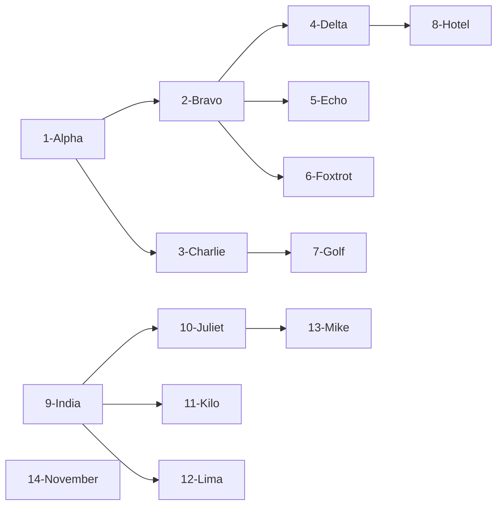

# 2026-11-14 PostgreSQL Recursive Queries (vs Python)

By [Vincentius Timothy](https://registry.jsonresume.org/vincentimo).

## Background

Recursive queries are useful for querying hierarchical or parent-child structures, such as:

1. referral system (referrer → referee → ...),
2. geographic location (country → ... → city → ...),
3. organizations (C-level → managers → employees), and
4. data lineage (ingest → transform → deliver).

In PostgreSQL, recursive queries are implemented as a recursive common table expression (CTE) using the keyword `WITH RECURSIVE`. This document describes how to use it with several use cases.

<!-- toc-gitlab:start mode=full -->
## Contents<br>
1. [Background](#background)
2. [Use case 1: Factorial](#use-case-1-factorial)
	1. [Problem statement](#problem-statement)
	2. [Python implementation](#python-implementation)
	3. [PostgreSQL implementation](#postgresql-implementation)
3. [How PostgreSQL evaluates recursive queries](#how-postgresql-evaluates-recursive-queries)
4. [Use case 2: Fibonacci sequence](#use-case-2-fibonacci-sequence)
	1. [Problem statement](#problem-statement-1)
	2. [Python implementation](#python-implementation-1)
	3. [PostgreSQL implementation](#postgresql-implementation-1)
5. [Use case 3: Referral system](#use-case-3-referral-system)
	1. [Problem statement](#problem-statement-2)
	2. [PostgreSQL implementation](#postgresql-implementation-2)
	3. [CTE `upward_cte`](#cte-upward_cte)
	4. [CTE `root_info`](#cte-root_info)
	5. [CTE `downward_cte`](#cte-downward_cte)
	6. [CTE `referee_info`](#cte-referee_info)
	7. [CTE `leaf_info`](#cte-leaf_info)
	8. [CTE `final_assembly`](#cte-final_assembly)
6. [References](#references)
<!-- toc-gitlab:end -->

## Use case 1: Factorial

### Problem statement

The [factorial](https://en.wikipedia.org/wiki/Factorial) of a non-negative integer $n$, is the product of all positive integers less than or equal to $n$. It also equals to the product of $n$ with the next smaller factorial.

$$\begin{align}
\text{fact}(n) &= \prod_{i=1}^{n} i = 1 \times 2 \times \dots \times (n-1) \times n\\
&= \begin{cases}
    1 & \text{if } n = 0 \\
    n \times \text{fact}(n-1) & \text{if } n > 0
  \end{cases}
\end{align}$$

### Python implementation

This is based on the two definitions of factorial above.

```python
def fact_iterative(n: int) -> int:
    """Bottom-up approach; implementing the first definition of factorial"""
    if n < 0:
        raise ValueError(f"Input must be non-negative: n = {n}")
    result = 1 # Base case
    for i in range(1, n + 1): # Iterative term
        result = result * i
    return result

def fact_recursive(n: int) -> int:
    """Top-down approach; implementing the second definition of factorial"""
    if n < 0:
        raise ValueError(f"Input must be non-negative: n = {n}")
    elif n == 0: # Base case
        return 1
    else: # Recursive term
        return n * fact_recursive(n - 1)

if __name__ == "__main__": # Main part
    print(fact_iterative(5))
    print(fact_recursive(5))
```

### PostgreSQL implementation

```sql
WITH RECURSIVE
    fact AS (
            /* Base case */
            SELECT
                0 AS n,
                1 AS result
        UNION ALL
            /* Recursive term */
            SELECT
                n + 1 AS n,
                result * (n + 1) AS result
            FROM
                fact
            WHERE
                n < 5
    )
/* Main part */
SELECT
    n,
    result
FROM
    fact;
```

Result:

| n   | result |
| --- | ------ |
| 0   | 1      |
| 1   | 1      |
| 2   | 2      |
| 3   | 6      |
| 4   | 24     |
| 5   | 120    |

The general form of a recursive query is always:

1. the Base case, then
2. `UNION ALL` (or `UNION`, only if you need to distinct, because the performance will suffer), then
3. the recursive term (only this part can call itself), then
4. the main part.

Observe that in the recursive term:

1. in the `FROM` clause: the way the `fact` CTE calls itself mimics the Python recursive implementation, and
2. in the `SELECT` clause: the way the variables are called mimics the Python iterative implementation.

## How PostgreSQL evaluates recursive queries

Unlike programming languages (like Python) which use a [call stack](https://en.wikipedia.org/wiki/Call_stack) to remember where they were during recursion, PostgreSQL evaluates recursive queries iteratively.

1. The Base case runs once and populates a temporary **working table** (in this case, `n = 0`).
2. The recursive term runs repeatedly, takes the output generated from the previous step, feeds it back into the query, and appends the new results to a temporary **intermediate table**.
3. Replace the contents of the working table with the contents of the intermediate table, then empty the intermediate table.
4. This loop repeats until the recursive step yields zero new rows or hits an explicit `WHERE` termination condition (in this case, `n < 5`).

> [!NOTE]
> While `RECURSIVE` allows queries to be specified recursively, internally such queries are evaluated iteratively.

## Use case 2: Fibonacci sequence

### Problem statement

The [Fibonacci sequence](https://en.wikipedia.org/wiki/Fibonacci_sequence) is a sequence in which each element is the sum of the two elements that precede it.

$$\text{fib}(n) = \begin{cases}
  0 & \text{if } n = 0 \\
  1 & \text{if } n = 1 \\
  \text{fib}(n - 1) + \text{fib}(n - 2) & \text{if } n > 1
\end{cases}$$

### Python implementation

```python
def fib_iterative(n: int) -> int:
    """Bottom-up approach, also known as tabulation"""
    if n < 0:
        raise ValueError(f"Input must be non-negative: n = {n}")
    elif n in (0, 1): # Base case
        return n 
    result = [None] * (n + 1)
    result[0], result[1] = 0, 1
    for i in range(2, n + 1): # Iterative term
        result[i] = result[i - 1] + result[i - 2]
    return result[n]

def fib_iterative_o1_space(n: int) -> int:
    """Bottom-up approach, optimized by not creating the list"""
    if n < 0:
        raise ValueError(f"Input must be non-negative: n = {n}")
    current_result, next_result = 0, 1 # Base case
    for _ in range(1, n + 1): # Iterative term
        current_result, next_result = next_result, next_result + current_result
    return current_result

def fib_recursive(n: int) -> int:
    """Top-down approach"""
    if n < 0:
        raise ValueError(f"Input must be non-negative: n = {n}")
    elif n in (0, 1): # Base case
        return n
    else: # Recursive term
        return fib_recursive(n - 1) + fib_recursive(n - 2)

def fib_recursive_memo(n: int, result: dict[int, int] | None = None) -> int:
    """Top-down approach, optimized with memoization"""
    if n < 0:
        raise ValueError(f"Input must be non-negative: n = {n}")
    if result is None: # Base case
        result = {0: 0, 1: 1}
    if n not in result: # Recursive term
        result[n] = fib_recursive_memo(n - 1, result) + fib_recursive_memo(n - 2, result)
    return result[n]

if __name__ == "__main__": # Main part
    print(fib_iterative(7))
    print(fib_iterative_o1_space(7))
    print(fib_recursive(7))
    print(fib_recursive_memo(7))
```

### PostgreSQL implementation

```sql
WITH RECURSIVE
    fib AS (
            /* Base case */
            SELECT
                0 AS n,
                0 AS current_result,
                1 AS next_result
        UNION ALL
            /* Recursive term */
            SELECT
                n + 1 AS n,
                next_result AS current_result,
                next_result + current_result AS next_result
            FROM
                fib
            WHERE
                n < 7
    )
/* Main part */
SELECT
    n,
    current_result AS result
FROM
    fib;
```

Result:

| n   | result |
| --- | ------ |
| 0   | 0      |
| 1   | 1      |
| 2   | 1      |
| 3   | 2      |
| 4   | 3      |
| 5   | 5      |
| 6   | 8      |
| 7   | 13     |

Observe that it mimics the Python implementation in function `fib_iterative_o1_space(n)`.

## Use case 3: Referral system

### Problem statement

Consider the following [referral tree](https://en.wikipedia.org/wiki/Referral_marketing) with format `{id}-{name}`.



How to read this:

1. `Alpha`, `India`, and `November` registered the app without any referrals.
2. `Bravo` and `Charlie` registered the app with `Alpha`'s referral.
3. `Delta`, `Echo`, and `Foxtrot` registered the app with `Bravo`'s referral.
4. `Golf` registered the app with `Charlie`'s referral.
5. `Hotel` registered the app with `Delta`'s referral.
6. `Juliet`, `Kilo`, and `Lima` registered the app with `India`'s referral.
7. `Mike` registered the app with `Juliet`'s referral.

We can represent this as a `dim_referral` table.

| id  | name     | referrer_id |
| --- | -------- | ----------- |
| 1   | Alpha    | ∅           |
| 2   | Bravo    | 1           |
| 3   | Charlie  | 1           |
| 4   | Delta    | 2           |
| 5   | Echo     | 2           |
| 6   | Foxtrot  | 2           |
| 7   | Golf     | 3           |
| 8   | Hotel    | 4           |
| 9   | India    | ∅           |
| 10  | Juliet   | 9           |
| 11  | Kilo     | 9           |
| 12  | Lima     | 9           |
| 13  | Mike     | 10          |
| 14  | November | ∅           |

> [!NOTE]
> This use case assumes clean data: `referrer_id` is either `NULL` or references an existing `id`, and the referral tree is acyclic. Dirty data handling, including cycles, is covered in the next use case.

Now, we want to extend this table to create `dim_referral_extended` table. Here's the specification.

| No  | Name                      | Type             | Description                                                                                        |
| --- | ------------------------- | ---------------- | -------------------------------------------------------------------------------------------------- |
| 1   | id                        | integer          | Primary key                                                                                        |
| 2   | name                      | text             | Customer name                                                                                      |
| 3   | referrer_id               | integer          | ID of the referrer                                                                                 |
| 4   | root_flag                 | boolean          | True if the topmost referrer ("root"), false otherwise                                             |
| 5   | root_referrer_id          | integer          | ID of the root. If this customer is the root itself, this equals their own ID                      |
| 6   | root_referrer_distance    | integer          | Number of steps from this customer to the root. If this customer is the root itself, this equals 0 |
| 7   | root_referrer_path_id     | array of integer | Array of IDs tracing the path from the root to this customer; mathematically, order matters        |
| 8   | root_referrer_path_name   | text             | Human-readable path from the root to this customer                                                 |
| 9   | direct_referee_count      | integer          | Number of direct (level-1) referees                                                                |
| 10  | direct_referee_list_id    | array of integer | Array of IDs of direct (level-1) referees; mathematically, order doesn't matter                    |
| 11  | recursive_referee_count   | integer          | Number of overall referees                                                                         |
| 12  | recursive_referee_list_id | array of integer | Array of IDs of overall referees; mathematically, order doesn't matter                             |
| 13  | max_depth                 | integer          | The maximum depth of the referees underneath this customer                                         |
| 14  | immediate_network_size    | integer          | Number of level-1 + level-2 referees                                                               |
| 15  | leaf_flag                 | boolean          | True if doesn't have any referees ("leaf"), false otherwise                                        |
| 16  | leaf_referee_count        | integer          | Number of leaf referees underneath this customer                                                   |
| 17  | leaf_referee_list_id      | array of integer | Array of IDs of leaf referees underneath this customer; mathematically, order doesn't matter       |

Here is the result of `dim_referral_extended`.

| id  | name     | referrer_id | root_flag | root_referrer_id | root_referrer_distance | root_referrer_path_id | root_referrer_path_name               | direct_referee_count | direct_referee_list_id | recursive_referee_count | recursive_referee_list_id | max_depth | immediate_network_size | leaf_flag | leaf_referee_count | leaf_referee_list_id |
| --- | -------- | ----------- | --------- | ---------------- | ---------------------- | --------------------- | ------------------------------------- | -------------------- | ---------------------- | ----------------------- | ------------------------- | --------- | ---------------------- | --------- | ------------------ | -------------------- |
| 1   | Alpha    | ∅           | ✅         | 1                | 0                      | {1}                   | 1-Alpha                               | 2                    | {2, 3}                 | 7                       | {2, 3, 4, 5, 6, 7, 8}     | 3         | 6                      | ❌         | 4                  | {5, 6, 7, 8}         |
| 2   | Bravo    | 1           | ❌         | 1                | 1                      | {1, 2}                | 1-Alpha > 2-Bravo                     | 3                    | {4, 5, 6}              | 4                       | {4, 5, 6, 8}              | 2         | 4                      | ❌         | 3                  | {5, 6, 8}            |
| 3   | Charlie  | 1           | ❌         | 1                | 1                      | {1, 3}                | 1-Alpha > 3-Charlie                   | 1                    | {7}                    | 1                       | {7}                       | 1         | 1                      | ❌         | 1                  | {7}                  |
| 4   | Delta    | 2           | ❌         | 1                | 2                      | {1, 2, 4}             | 1-Alpha > 2-Bravo > 4-Delta           | 1                    | {8}                    | 1                       | {8}                       | 1         | 1                      | ❌         | 1                  | {8}                  |
| 5   | Echo     | 2           | ❌         | 1                | 2                      | {1, 2, 5}             | 1-Alpha > 2-Bravo > 5-Echo            | 0                    | {}                     | 0                       | {}                        | 0         | 0                      | ✅         | 0                  | {}                   |
| 6   | Foxtrot  | 2           | ❌         | 1                | 2                      | {1, 2, 6}             | 1-Alpha > 2-Bravo > 6-Foxtrot         | 0                    | {}                     | 0                       | {}                        | 0         | 0                      | ✅         | 0                  | {}                   |
| 7   | Golf     | 3           | ❌         | 1                | 2                      | {1, 3, 7}             | 1-Alpha > 3-Charlie > 7-Golf          | 0                    | {}                     | 0                       | {}                        | 0         | 0                      | ✅         | 0                  | {}                   |
| 8   | Hotel    | 4           | ❌         | 1                | 3                      | {1, 2, 4, 8}          | 1-Alpha > 2-Bravo > 4-Delta > 8-Hotel | 0                    | {}                     | 0                       | {}                        | 0         | 0                      | ✅         | 0                  | {}                   |
| 9   | India    | ∅           | ✅         | 9                | 0                      | {9}                   | 9-India                               | 3                    | {10, 11, 12}           | 4                       | {10, 11, 12, 13}          | 2         | 4                      | ❌         | 3                  | {11, 12, 13}         |
| 10  | Juliet   | 9           | ❌         | 9                | 1                      | {9, 10}               | 9-India > 10-Juliet                   | 1                    | {13}                   | 1                       | {13}                      | 1         | 1                      | ❌         | 1                  | {13}                 |
| 11  | Kilo     | 9           | ❌         | 9                | 1                      | {9, 11}               | 9-India > 11-Kilo                     | 0                    | {}                     | 0                       | {}                        | 0         | 0                      | ✅         | 0                  | {}                   |
| 12  | Lima     | 9           | ❌         | 9                | 1                      | {9, 12}               | 9-India > 12-Lima                     | 0                    | {}                     | 0                       | {}                        | 0         | 0                      | ✅         | 0                  | {}                   |
| 13  | Mike     | 10          | ❌         | 9                | 2                      | {9, 10, 13}           | 9-India > 10-Juliet > 13-Mike         | 0                    | {}                     | 0                       | {}                        | 0         | 0                      | ✅         | 0                  | {}                   |
| 14  | November | ∅           | ✅         | 14               | 0                      | {14}                  | 14-November                           | 0                    | {}                     | 0                       | {}                        | 0         | 0                      | ✅         | 0                  | {}                   |

### PostgreSQL implementation

Now let's implement it in PostgreSQL. Here's the SQL to create `dim_referral`.

```sql
CREATE TABLE IF NOT EXISTS dim_referral (
    id INTEGER PRIMARY KEY,
    name TEXT,
    referrer_id INTEGER REFERENCES dim_referral(id)
);

INSERT INTO dim_referral
VALUES
    (1, 'Alpha', NULL),
    (2, 'Bravo', 1),
    (3, 'Charlie', 1),
    (4, 'Delta', 2),
    (5, 'Echo', 2),
    (6, 'Foxtrot', 2),
    (7, 'Golf', 3),
    (8, 'Hotel', 4),
    (9, 'India', NULL),
    (10, 'Juliet', 9),
    (11, 'Kilo', 9),
    (12, 'Lima', 9),
    (13, 'Mike', 10),
    (14, 'November', NULL);
```

Here's the SQL to create `dim_referral_extended`.

```sql
CREATE TABLE IF NOT EXISTS dim_referral_extended (
    id INTEGER PRIMARY KEY,
    name TEXT,
    referrer_id INTEGER REFERENCES dim_referral_extended(id),
    root_flag BOOLEAN,
    root_referrer_id INTEGER,
    root_referrer_distance INTEGER,
    root_referrer_path_id INTEGER[],
    root_referrer_path_name TEXT,
    direct_referee_count INTEGER,
    direct_referee_list_id INTEGER[],
    recursive_referee_count INTEGER,
    recursive_referee_list_id INTEGER[],
    max_depth INTEGER,
    immediate_network_size INTEGER,
    leaf_flag BOOLEAN,
    leaf_referee_count INTEGER,
    leaf_referee_list_id INTEGER[]
);

INSERT INTO dim_referral_extended
WITH RECURSIVE 
    /* 1. Traverses every customer upwards until the root referrer and builds the tracing path */
    upward_cte AS (
            /* Base case */
            SELECT 
                id AS original_id,
                id AS current_id,
                referrer_id,
                0 AS distance,
                ARRAY[id] AS path_id,
                ARRAY[id || '-' || name] AS path_name
            FROM
                dim_referral
        UNION ALL
            /* Recursive term */
            SELECT 
                upward_cte.original_id AS original_id,
                upward_cte.referrer_id AS current_id, /* Traverses upwards so the upward_cte's referrer_id becomes the current_id */
                dim_referral.referrer_id AS referrer_id,
                upward_cte.distance + 1 AS distance,
                ARRAY[upward_cte.referrer_id] || upward_cte.path_id AS path_id, /* Concats the current_id to the beginning of the array; mathematically, order matters */
                ARRAY[upward_cte.referrer_id::TEXT || '-' || dim_referral.name] || upward_cte.path_name AS path_name
            FROM
                upward_cte
            INNER JOIN
                dim_referral
            ON
                upward_cte.referrer_id = dim_referral.id /* The recursive term runs repeatedly until the upward_cte's referrer_id IS NULL, thus yielding zero new rows */
    ),
    /* 2. Takes only rows that have reached the root referrer, i.e., the rows that don't have referrer_id */
    root_info AS (
        SELECT 
            original_id AS id,
            distance = 0 AS root_flag,
            path_id[1] AS root_referrer_id, /* The first element of path_id becomes the root_referrer_id */
            distance AS root_referrer_distance,
            path_id AS root_referrer_path_id,
            ARRAY_TO_STRING(path_name, ' > ') AS root_referrer_path_name
        FROM
            upward_cte
        WHERE
            referrer_id IS NULL
    ),
    /* 3. Finds all referees of a customer and their distance by flipping the perspective from upward_cte */
    downward_cte AS (
        SELECT
            current_id AS id,
            original_id AS referee_id, /* The upward_cte's original_id becomes the referee_id because we flip the perspective */
            distance
        FROM
            upward_cte
        WHERE
            distance <> 0 /* Contains only customers that have 1+ referees */
    ),
    /* 4. Calculates metrics related to referee */
    referee_info AS (
        SELECT
            id,
            COUNT(referee_id) FILTER(WHERE distance = 1) AS direct_referee_count,
            ARRAY_AGG(referee_id) FILTER(WHERE distance = 1) AS direct_referee_list_id, /* Intentionally not given ORDER BY; mathematically, order doesn't matter */
            COUNT(referee_id) AS recursive_referee_count,
            ARRAY_AGG(referee_id) AS recursive_referee_list_id, /* Intentionally not given ORDER BY; mathematically, order doesn't matter */
            MAX(distance) AS max_depth,
            COUNT(referee_id) FILTER(WHERE distance IN (1, 2)) AS immediate_network_size
        FROM
            downward_cte
        GROUP BY
            id
    ),
    /* 5. Calculates metrics related to leaf */
    leaf_info AS (
        SELECT
            id,
            COUNT(referee_id) AS leaf_referee_count,
            ARRAY_AGG(referee_id) AS leaf_referee_list_id /* Intentionally not given ORDER BY; mathematically, order doesn't matter */
        FROM
            downward_cte
        WHERE
            NOT EXISTS (
                SELECT
                    1
                FROM
                    dim_referral
                WHERE
                    downward_cte.referee_id = dim_referral.referrer_id
            )
        GROUP BY
            id
    ),
    /* 6. Joins everything together */
    final_assembly AS (
        SELECT 
            dim_referral.id,
            dim_referral.name,
            dim_referral.referrer_id,
            root_info.root_flag,
            root_info.root_referrer_id,
            root_info.root_referrer_distance,
            root_info.root_referrer_path_id,
            root_info.root_referrer_path_name,
            COALESCE(referee_info.direct_referee_count, 0) AS direct_referee_count,
            COALESCE(referee_info.direct_referee_list_id, ARRAY[]::INTEGER[]) AS direct_referee_list_id,
            COALESCE(referee_info.recursive_referee_count, 0) AS recursive_referee_count,
            COALESCE(referee_info.recursive_referee_list_id, ARRAY[]::INTEGER[]) AS recursive_referee_list_id,
            COALESCE(referee_info.max_depth, 0) AS max_depth,
            COALESCE(referee_info.immediate_network_size, 0) AS immediate_network_size,
            COALESCE(referee_info.direct_referee_count, 0) = 0 AS leaf_flag,
            COALESCE(leaf_info.leaf_referee_count, 0) AS leaf_referee_count,
            COALESCE(leaf_info.leaf_referee_list_id, ARRAY[]::INTEGER[]) AS leaf_referee_list_id
        FROM
            dim_referral
        LEFT JOIN
            root_info
        ON
            dim_referral.id = root_info.id
        LEFT JOIN
            referee_info
        ON
            dim_referral.id = referee_info.id
        LEFT JOIN
            leaf_info
        ON
            dim_referral.id = leaf_info.id
    )
/* Main part */
SELECT
    *
FROM
    final_assembly;
```

To understand what happened, let's see the result of each CTE.

### CTE `upward_cte`

> [!NOTE]
> The purpose of this CTE is to:
> 1. traverse every customer upwards until the root referrer, with increasing distance, and
> 2. build the tracing path, both as an array of ID, and the human-readable one.

To make it easier to understand, change the main part of the query to this.

```sql
/* Main part */
SELECT
    *
FROM
    upward_cte
ORDER BY
    original_id,
    distance;
```

Here is the result.

| original_id | current_id | referrer_id | distance | path_id      | path_name                            | comment                           |
| ----------- | ---------- | ----------- | -------- | ------------ | ------------------------------------ | --------------------------------- |
| 1           | 1          | ∅           | 0        | {1}          | {1-Alpha}                            | **Base case** - **reaches root**  |
| 2           | 2          | 1           | 0        | {2}          | {2-Bravo}                            | **Base case**                     |
| 2           | 1          | ∅           | 1        | {1, 2}       | {1-Alpha, 2-Bravo}                   | Recursive term - **reaches root** |
| 3           | 3          | 1           | 0        | {3}          | {3-Charlie}                          | **Base case**                     |
| 3           | 1          | ∅           | 1        | {1, 3}       | {1-Alpha, 3-Charlie}                 | Recursive term - **reaches root** |
| 4           | 4          | 2           | 0        | {4}          | {4-Delta}                            | **Base case**                     |
| 4           | 2          | 1           | 1        | {2, 4}       | {2-Bravo, 4-Delta}                   | Recursive term                    |
| 4           | 1          | ∅           | 2        | {1, 2, 4}    | {1-Alpha, 2-Bravo, 4-Delta}          | Recursive term - **reaches root** |
| 5           | 5          | 2           | 0        | {5}          | {5-Echo}                             | **Base case**                     |
| 5           | 2          | 1           | 1        | {2, 5}       | {2-Bravo, 5-Echo}                    | Recursive term                    |
| 5           | 1          | ∅           | 2        | {1, 2, 5}    | {1-Alpha, 2-Bravo, 5-Echo}           | Recursive term - **reaches root** |
| 6           | 6          | 2           | 0        | {6}          | {6-Foxtrot}                          | **Base case**                     |
| 6           | 2          | 1           | 1        | {2, 6}       | {2-Bravo, 6-Foxtrot}                 | Recursive term                    |
| 6           | 1          | ∅           | 2        | {1, 2, 6}    | {1-Alpha, 2-Bravo, 6-Foxtrot}        | Recursive term - **reaches root** |
| 7           | 7          | 3           | 0        | {7}          | {7-Golf}                             | **Base case**                     |
| 7           | 3          | 1           | 1        | {3, 7}       | {3-Charlie, 7-Golf}                  | Recursive term                    |
| 7           | 1          | ∅           | 2        | {1, 3, 7}    | {1-Alpha, 3-Charlie, 7-Golf}         | Recursive term - **reaches root** |
| 8           | 8          | 4           | 0        | {8}          | {8-Hotel}                            | **Base case**                     |
| 8           | 4          | 2           | 1        | {4, 8}       | {4-Delta, 8-Hotel}                   | Recursive term                    |
| 8           | 2          | 1           | 2        | {2, 4, 8}    | {2-Bravo, 4-Delta, 8-Hotel}          | Recursive term                    |
| 8           | 1          | ∅           | 3        | {1, 2, 4, 8} | {1-Alpha, 2-Bravo, 4-Delta, 8-Hotel} | Recursive term - **reaches root** |
| 9           | 9          | ∅           | 0        | {9}          | {9-India}                            | **Base case** - **reaches root**  |
| 10          | 10         | 9           | 0        | {10}         | {10-Juliet}                          | **Base case**                     |
| 10          | 9          | ∅           | 1        | {9, 10}      | {9-India, 10-Juliet}                 | Recursive term - **reaches root** |
| 11          | 11         | 9           | 0        | {11}         | {11-Kilo}                            | **Base case**                     |
| 11          | 9          | ∅           | 1        | {9, 11}      | {9-India, 11-Kilo}                   | Recursive term - **reaches root** |
| 12          | 12         | 9           | 0        | {12}         | {12-Lima}                            | **Base case**                     |
| 12          | 9          | ∅           | 1        | {9, 12}      | {9-India, 12-Lima}                   | Recursive term - **reaches root** |
| 13          | 13         | 10          | 0        | {13}         | {13-Mike}                            | **Base case**                     |
| 13          | 10         | 9           | 1        | {10, 13}     | {10-Juliet, 13-Mike}                 | Recursive term                    |
| 13          | 9          | ∅           | 2        | {9, 10, 13}  | {9-India, 10-Juliet, 13-Mike}        | Recursive term - **reaches root** |
| 14          | 14         | ∅           | 0        | {14}         | {14-November}                        | **Base case** - **reaches root**  |

### CTE `root_info`

> [!NOTE]
> The purpose of this CTE is to take only rows that have reached the root referrer, i.e., the rows that don't have `referrer_id`.

To make it easier to understand, change the main part of the query to this.

```sql
/* Main part */
SELECT
    *
FROM
    root_info
ORDER BY
    id;
```

Here is the result.

| id  | root_flag | root_referrer_id | root_referrer_distance | root_referrer_path_id | root_referrer_path_name               |
| --- | --------- | ---------------- | ---------------------- | --------------------- | ------------------------------------- |
| 1   | ✅         | 1                | 0                      | {1}                   | 1-Alpha                               |
| 2   | ❌         | 1                | 1                      | {1, 2}                | 1-Alpha > 2-Bravo                     |
| 3   | ❌         | 1                | 1                      | {1, 3}                | 1-Alpha > 3-Charlie                   |
| 4   | ❌         | 1                | 2                      | {1, 2, 4}             | 1-Alpha > 2-Bravo > 4-Delta           |
| 5   | ❌         | 1                | 2                      | {1, 2, 5}             | 1-Alpha > 2-Bravo > 5-Echo            |
| 6   | ❌         | 1                | 2                      | {1, 2, 6}             | 1-Alpha > 2-Bravo > 6-Foxtrot         |
| 7   | ❌         | 1                | 2                      | {1, 3, 7}             | 1-Alpha > 3-Charlie > 7-Golf          |
| 8   | ❌         | 1                | 3                      | {1, 2, 4, 8}          | 1-Alpha > 2-Bravo > 4-Delta > 8-Hotel |
| 9   | ✅         | 9                | 0                      | {9}                   | 9-India                               |
| 10  | ❌         | 9                | 1                      | {9, 10}               | 9-India > 10-Juliet                   |
| 11  | ❌         | 9                | 1                      | {9, 11}               | 9-India > 11-Kilo                     |
| 12  | ❌         | 9                | 1                      | {9, 12}               | 9-India > 12-Lima                     |
| 13  | ❌         | 9                | 2                      | {9, 10, 13}           | 9-India > 10-Juliet > 13-Mike         |
| 14  | ✅         | 14               | 0                      | {14}                  | 14-November                           |

### CTE `downward_cte`

> [!NOTE]
> The purpose of this CTE is to find all referees of a customer and their distance by flipping the perspective from `upward_cte`. Contains only customers that have 1+ referees.

To make it easier to understand, change the main part of the query to this.

```sql
/* Main part */
SELECT
    *
FROM
    downward_cte
ORDER BY
    current_id,
    distance,
    referee_id;
```

Here is the result.

| current_id | referee_id | distance |
| ---------- | ---------- | -------- |
| 1          | 2          | 1        |
| 1          | 3          | 1        |
| 1          | 4          | 2        |
| 1          | 5          | 2        |
| 1          | 6          | 2        |
| 1          | 7          | 2        |
| 1          | 8          | 3        |
| 2          | 4          | 1        |
| 2          | 5          | 1        |
| 2          | 6          | 1        |
| 2          | 8          | 2        |
| 3          | 7          | 1        |
| 4          | 8          | 1        |
| 9          | 10         | 1        |
| 9          | 11         | 1        |
| 9          | 12         | 1        |
| 9          | 13         | 2        |
| 10         | 13         | 1        |

### CTE `referee_info`

> [!NOTE]
> The purpose of this CTE is to calculate metrics related to referee. Contains only customers that have 1+ referees.

To make it easier to understand, change the main part of the query to this.

```sql
/* Main part */
SELECT
    *
FROM
    referee_info
ORDER BY
    id;
```

Here is the result.

| id  | direct_referee_count | direct_referee_list_id | recursive_referee_count | recursive_referee_list_id | max_depth | immediate_network_size |
| --- | -------------------- | ---------------------- | ----------------------- | ------------------------- | --------- | ---------------------- |
| 1   | 2                    | {2, 3}                 | 7                       | {2, 3, 4, 5, 6, 7, 8}     | 3         | 6                      |
| 2   | 3                    | {4, 5, 6}              | 4                       | {4, 5, 6, 8}              | 2         | 4                      |
| 3   | 1                    | {7}                    | 1                       | {7}                       | 1         | 1                      |
| 4   | 1                    | {8}                    | 1                       | {8}                       | 1         | 1                      |
| 9   | 3                    | {10, 11, 12}           | 4                       | {10, 11, 12, 13}          | 2         | 4                      |
| 10  | 1                    | {13}                   | 1                       | {13}                      | 1         | 1                      |

### CTE `leaf_info`

> [!NOTE]
> The purpose of this CTE is to calculate metrics related to leaf. Contains only customers that have 1+ referees.

To make it easier to understand, change the main part of the query to this.

```sql
/* Main part */
SELECT
    *
FROM
    leaf_info
ORDER BY
    id;
```

Here is the result.

| id  | leaf_referee_count | leaf_referee_list_id |
| --- | ------------------ | -------------------- |
| 1   | 4                  | {5, 6, 7, 8}         |
| 2   | 3                  | {5, 6, 8}            |
| 3   | 1                  | {7}                  |
| 4   | 1                  | {8}                  |
| 9   | 3                  | {11, 12, 13}         |
| 10  | 1                  | {13}                 |

### CTE `final_assembly`

> [!NOTE]
> The purpose of this CTE is to join everything together. Note that:
> 1. integer metrics from `referee_info` are `COALESCE`-d with 0 to prevent `NULL` values for customers who do not have any referees, and
> 2. array metrics from `referee_info` are `COALESCE`-d with `ARRAY[]::INTEGER[]` to prevent `NULL` values for such customers.

The result of the query is table `dim_referral_extended`.

## References

1. https://www.postgresql.org/docs/current/queries-with.html
2. https://www.geeksforgeeks.org/postgresql/postgresql-recursive-query/